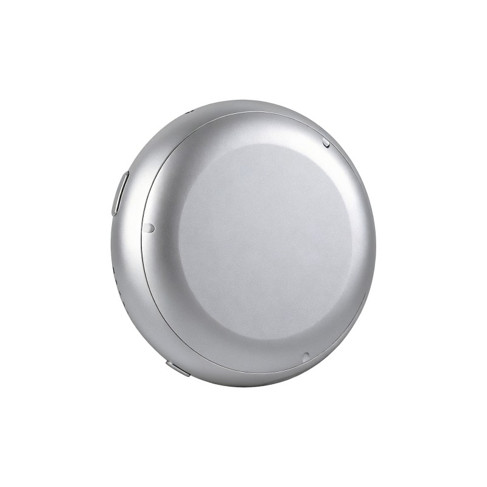

# ESP32 Luna Shell / Cody Companion

**Cody Companion** is a round, dedicated terminal for Codex. Keep it on your desk
or bedside table to see when a turn is ready, answer a question sent to Cody,
and check usage without picking up a phone. The device talks to the Codex plugin
on the same local Wi-Fi network.

The VibeWare floppy animation hands off to the Muse character. Tap the
character for a playful reaction with Cody's touch sound when enabled. Press
BOOT to open Options and use Connections for Wi-Fi setup and Codex pairing.

- **Codex at a glance.** The dashboard distinguishes a connected app, a linked
  PC and active discovery. Authenticated questions and turn-ready events can
  wake the display from connected standby and play a cue when sounds are enabled.
- **Account and device screens.** Browse reset, limits, usage, credits, context
  and About. A five-pixel perimeter shows the current weekly allowance on the statistics
  screens when a valid sample is available. About includes build details and a project QR.
- **Physical controls.** PWR toggles standby, BOOT opens Options and a shake
  returns to the first enabled statistics page. Optional voice input uses the
  paired local link. The standard profile keeps the microphone pipeline disabled.

**Luna Shell** is the other interface in this repository. It uses Espressif's
ESP-Brookesia and shares the same hardware layer.

## Why I built Cody

I wanted a small terminal I could make my own. Much larger companies
are exploring similar ideas. I built Cody so that the person who owns the
device gets to decide what software it runs, what it connects to, and what
else the hardware can be used for.

When a single vendor controls the firmware and integrations, it can set the
limits on what you do with hardware you already own. I keep Cody open source
so those decisions stay with the people who use it. You can inspect and change
the firmware and plugin, flash your own build onto the ESP32, adapt the
integrations to your tools, or reuse the board for a project of your own.

## The little round thing

The default target is the **Waveshare ESP32-S3-Touch-AMOLED-1.75 GPS** with
16 MB of flash. For the **1.75C** with 32 MB of flash and the aluminum case
pictured below, select `-Board waveshare-esp32s3-touch-amoled-1.75c`. Both
use a round 466 × 466 display. Their pin assignments and onboard peripherals
differ. The **1.43C** has a hardware reference only. [Board comparison](docs/bsp/boards/purchased-amoled-comparison.md) · [Open hardware checks](TODO.md)

  
   
  
   
  <em>Official Waveshare product photos. Image rights belong to their respective owners.</em>

Standby, wake and battery behavior are described in the
[power guide](docs/bsp/services/power-management.md).

## Pick a door

- **Use Cody:** [setup and navigation](docs/cody/navigation.md), the
  [A4 route map](docs/cody/device-navigation-map-a4.pdf), the [PC plugin](cody-desktop/plugins/cody-codex-plugin/README.md)
  and [Linux plugin installation](cody-desktop/plugins/cody-codex-plugin/README.md#install-on-linux).
- **Desktop widget:** [OpenAI Usage](cody-desktop/widgets/codex-status/README.md), a standalone
  Windows/Linux widget for Codex allowance, tokens, credits and reset countdown.
- **Build something:** [Cody's native 2D interface](docs/cody/README.md),
  [Luna's Brookesia interface](docs/luna-shell/README.md), or the [shared hardware layer](docs/bsp/README.md).
- **Find the details:** [documentation and atlases](docs/README.md),
  [device console](scripts/README.md), and [open work](TODO.md).

Development uses **ESP-IDF 6.0.2** and, for Luna, **ESP-Brookesia 0.8** with LVGL.
Cody uses its own native 2D renderer. `scripts/device.ps1` is the command-line
entry point; [AGENTS.md](AGENTS.md) has the working agreements.

## Checkout layout

- [cody-device/](cody-device/) contains the ESP32 firmware project, hardware references, assets and host simulator.
- [cody-desktop/](cody-desktop/) contains the Cody Codex plugin and the OpenAI Usage widget.
- [docs/](docs/) contains the public documentation. Run device operations through [scripts/device.ps1](scripts/device.ps1) from the repository root. Generated output belongs in artifacts/.
- Cody Cloud is a separate private Git checkout. Keep it beside this repository as cody-cloud.

## The small print, kept small

I'm not affiliated with, sponsored by, or employed by **Espressif** or
**Waveshare**. This is my independent project, not an official product from
either company. All third-party names, trademarks, logos and images belong to
their respective owners.

My source and documentation use the [MIT License](LICENSE). Third-party code,
models and assets keep their [own licenses and notices](THIRD_PARTY_NOTICES.md);
the VibeWare identity has its own [reuse guidance](https://github.com/umbertotechnopreneur/VibeWare/blob/main/PRESS-KIT.md).

On first import, check the official source and version, then run a targeted
Microsoft Defender scan of the download and extracted dependencies. Use the
import after the scan completes without detections.

---

### This is VibeWare · [Manifesto](https://umbertogiacobbi.biz/vibeware/manifesto?utm_source=github&utm_medium=referral&utm_campaign=esp32-luna-shell&utm_content=readme-manifesto)

ESP32 Luna Shell / Cody Companion participates in the **VibeWare initiative**,
an open movement for developers who build useful software with AI under human
direction. VibeWare describes participation; it is not the project's author
or publisher.

I am [Umberto Giacobbi](https://umbertogiacobbi.biz/?utm_source=github&utm_medium=referral&utm_campaign=esp32-luna-shell&utm_content=readme-author).
I guide this project's development and remain responsible for checking the
result. The project keeps its own identity, license and release status.

To learn what VibeWare means and why I started it, read the manifesto above.

[ESP32 Luna Shell on GitHub](https://github.com/umbertotechnopreneur/esp32-luna-shell) ·
[VibeWare on GitHub](https://github.com/umbertotechnopreneur/VibeWare) ·
[umbertogiacobbi.biz](https://umbertogiacobbi.biz/?utm_source=github&utm_medium=referral&utm_campaign=esp32-luna-shell&utm_content=readme-website)

*Explore, adapt and reuse the project materials under their applicable licenses.*

[Terms](https://umbertogiacobbi.biz/terms/?utm_source=github&utm_medium=referral&utm_campaign=esp32-luna-shell&utm_content=readme-terms) ·
[Privacy](https://umbertogiacobbi.biz/privacy/?utm_source=github&utm_medium=referral&utm_campaign=esp32-luna-shell&utm_content=readme-privacy)

   
  <em>Human Intent, AI Execution, Plenty of Token</em>

