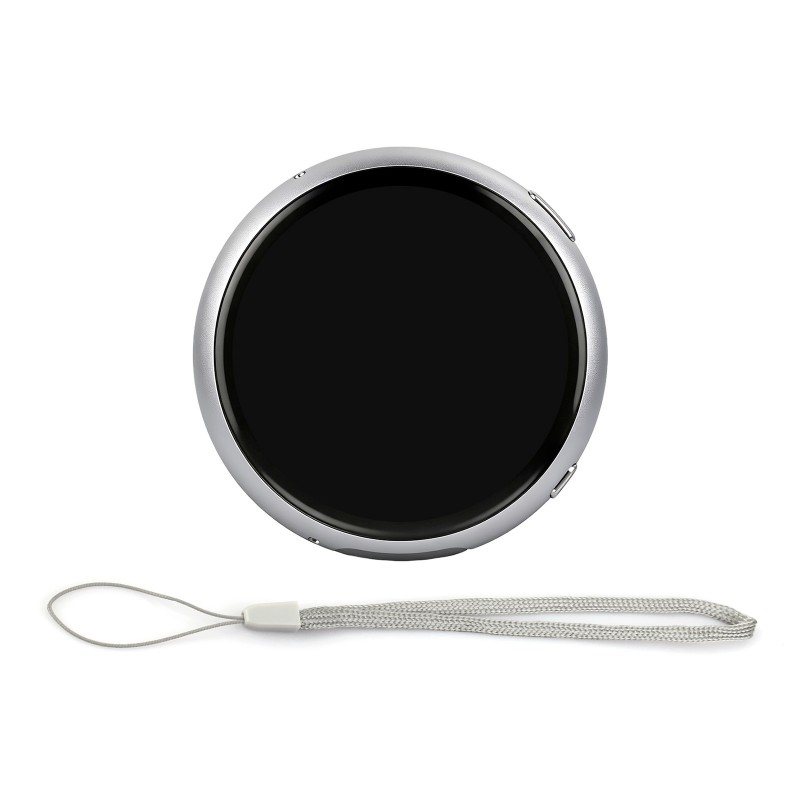
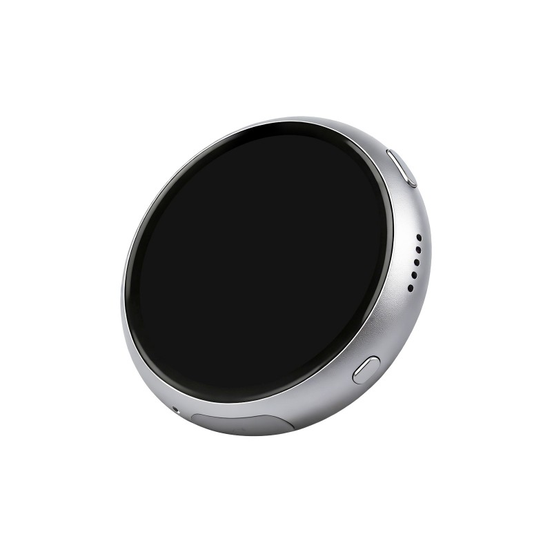
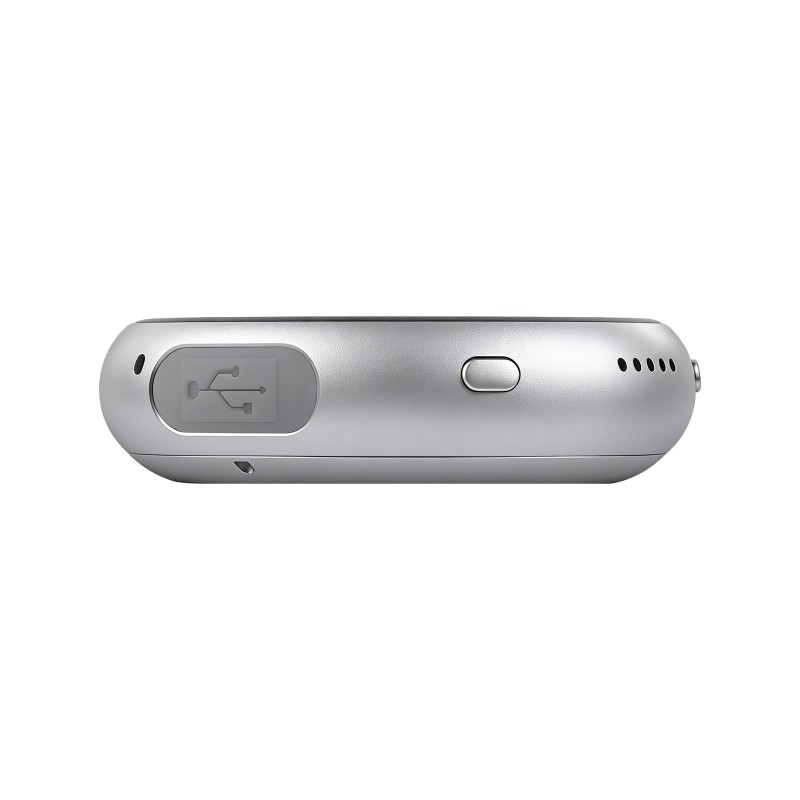
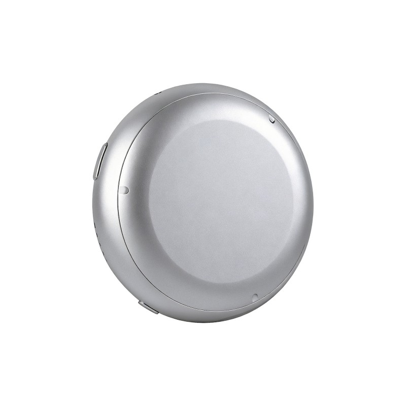

# ESP32 Luna Shell / Cody Companion

A small round screen, a little personality, and a surprising amount of C++.

**Cody Companion** is a **Codex plugin and a little device for your desk**.
The plugin brings Codex's hooks out of the app and into the physical world:
Cody shows what your coding assistant is doing, which model it's using and how
much context is left. Codex can send notifications and questions to Cody, and
you can tap an answer on Cody to send it back to the chat. It goes both ways.

Setup starts on your phone: Bluetooth helps you configure Cody's Wi-Fi, so
there's no password to peck out on a tiny round screen. Then you pair it with
the Codex plugin using the code shown on Cody. From there, device and plugin
communicate over your **local Wi-Fi network**. Remote connections are on the
wish list; for now, they share the same neighborhood.

Cody does more than sit there looking round:

- **Wake word and standby.** With wake-word listening enabled, Cody recognizes
  **Sophia** locally and can wake from listening standby. On battery it can take
  inactivity naps; powered over USB and connected to Codex, it stays awake for work.
- **A bit of personality.** Touch interaction, animations and sound cues bring
  activity and notifications to life. Yes, you can pet your coding sidekick.
- **Make it yours.** Pick a look, switch sounds on or off, and configure rotation,
  shake-to-wake and Desk/Away behavior.

**Luna Shell** is the other interface in this repository, built on Espressif's
ESP-Brookesia and sharing the hardware layer. Both are works in progress.
Cody already has opinions about your token budget; polishing the rest is my job.

## The little round thing

Cody was developed and tested on the **Waveshare ESP32-S3-Touch-AMOLED-1.75 GPS**.
I bought the **Waveshare ESP32-S3-Touch-AMOLED-1.75C** pictured below for its aluminum
case. The round display, ESP32-S3 resources, Waveshare's build quality and price
felt like a good match. Also, a tiny desk companion deserves a decent outfit.

  
   
  
   
  <em>Official Waveshare product photos. Image rights belong to their respective owners.</em>

The interface is separate from the board, so other Espressif devices can join in
with their own integration. [Hardware details](docs/bsp/boards/purchased-amoled-comparison.md).

Battery so far: **about seven hours on 1,000 mAh** in one Cody Debug run, with
wake-word listening and the activity observer enabled. A useful observation,
not a stopwatch promise. [Configuration and evidence](docs/bsp/services/power-management.md#observed-1000-mah-run---12-13-october-2026).

## Pick a door

- **Use Cody:** [setup and navigation](docs/cody/navigation.md), then the
  [PC plugin](plugins/cody-codex-plugin/README.md).
- **Build something:** [Cody's native 2D interface](docs/cody/README.md),
  [Luna's Brookesia interface](docs/luna-shell/README.md), or the [shared hardware layer](docs/bsp/README.md).
- **Find the details:** [documentation and atlases](docs/README.md),
  [device console](scripts/README.md), and [open work](TODO.md).

Development uses **ESP-IDF 6.0.2** and, for Luna, **ESP-Brookesia 0.8** with LVGL.
Cody uses its own native 2D renderer. `scripts/device.ps1` is the command-line
entry point; [AGENTS.md](AGENTS.md) has the working agreements.

## The small print, kept small

I'm not affiliated with, sponsored by, or employed by **Espressif** or
**Waveshare**. This is my independent project, not an official product from
either company. All third-party names, trademarks, logos and images belong to
their respective owners.

My source and documentation use the [MIT License](LICENSE). Third-party code,
models and assets keep their [own licenses and notices](THIRD_PARTY_NOTICES.md);
the VibeWare identity has its own [reuse guidance](https://github.com/umbertotechnopreneur/VibeWare/blob/main/PRESS-KIT.md).

New external libraries and binaries get a Microsoft Defender scan of the download,
extracted files and imported dependencies before use. I record the source and
result; failed, incomplete or flagged scans keep the import on hold.

---

### This is VibeWare · [Manifesto](https://umbertogiacobbi.biz/vibeware/manifesto?utm_source=github&utm_medium=referral&utm_campaign=esp32-luna-shell&utm_content=readme-manifesto)

ESP32 Luna Shell / Cody Companion participates in the **VibeWare initiative**,
an open movement for developers who build useful software with AI under human
direction. VibeWare describes participation; it is not the project's author
or publisher.

I am [Umberto Giacobbi](https://umbertogiacobbi.biz/?utm_source=github&utm_medium=referral&utm_campaign=esp32-luna-shell&utm_content=readme-author).
I guide this project's development and remain responsible for checking the
result. The project keeps its own identity, license, release status and
validation evidence.

To learn what VibeWare means and why I started it, read the manifesto above.

[ESP32 Luna Shell on GitHub](https://github.com/umbertotechnopreneur/esp32-luna-shell) ·
[VibeWare on GitHub](https://github.com/umbertotechnopreneur/VibeWare) ·
[umbertogiacobbi.biz](https://umbertogiacobbi.biz/?utm_source=github&utm_medium=referral&utm_campaign=esp32-luna-shell&utm_content=readme-website)

*Explore, adapt and reuse the project materials under their applicable licenses.*

[Terms](https://umbertogiacobbi.biz/terms/?utm_source=github&utm_medium=referral&utm_campaign=esp32-luna-shell&utm_content=readme-terms) ·
[Privacy](https://umbertogiacobbi.biz/privacy/?utm_source=github&utm_medium=referral&utm_campaign=esp32-luna-shell&utm_content=readme-privacy)

   
  <em>Human Intent, AI Execution, Plenty of Token</em>

