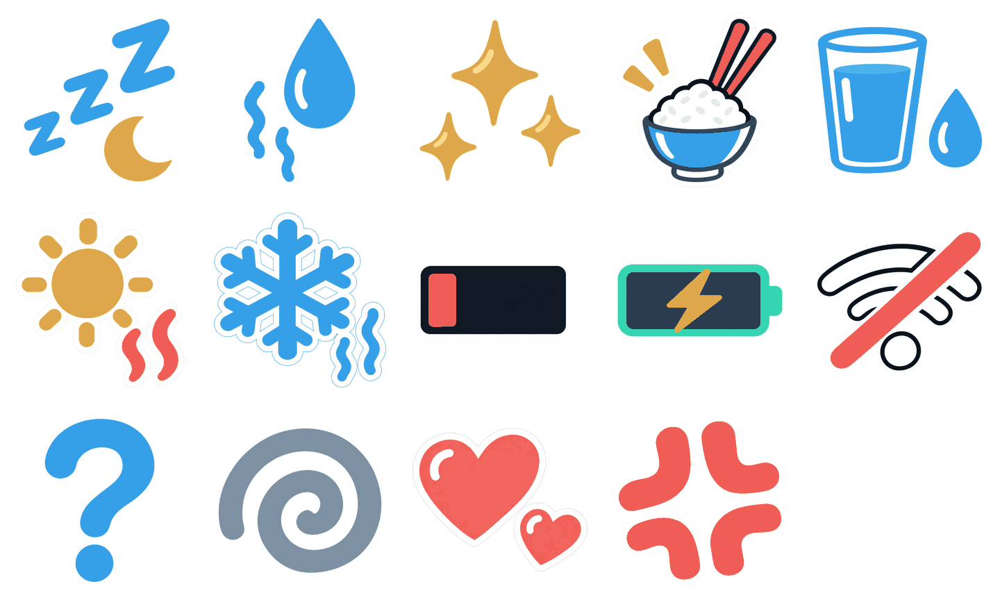

# Cody manga personality symbols

Fourteen standalone symbols share one fixed catalog across Pearl Mist, Aurora
Veil, Cosmic Stardust, Enchanted Mosaic and Dreamwave. They contain no cloud,
character, skin paint, embedded caption or sensor value. Only one symbol is
active at a time; `None` is the default session request.



The preserved ImageGen sources and exact prompts are in `source/`. On 2026-10-07
all fourteen symbols were redrawn individually at maximum native square
resolution, preserving the familiar identities from the original manga atlas.
`source/masters-v2/` contains the native transparent masters; the original atlas
and historic skin sheets/PDFs remain preserved. Retained
4-connected alpha components isolate the intended symbols from detached noise.
Intentional disconnected Z letters, question dot, hearts, rays, motion strokes
and sparkles survive the authored area threshold. `generated/manifest.json`
records each native source size/hash, component bounds/counts,
retention decisions, palette hash, used slots and output byte hashes.

Regenerate only through the public device CLI:

```powershell
./scripts/device.ps1 generate -Generator cody-personality-icons -PythonExecutable <python-with-Pillow>
```

Each 256 x 256 master has a 65,536-byte canonical palette-index plane and a
separate 65,536-byte alpha8 coverage plane. This covers the renderer's maximum
231-pixel destination without enlarging a low-resolution texture.
The generator uses the exact 256
slots in `assets/cody/palette/palette256.json`, retains their order and never
selects a reserved slot. Nearest squared sRGB distance selects the lowest
eligible slot on ties; there is no dithering or palette mutation. Transparent
pixels have zero coverage, independently of their color index; black stays a
real color. The original violet confusion spiral consequently maps to the
closest eligible gray-blue. The runtime is not given a new violet entry.

`*.indexed.png` uses a full, canonical 256-entry PNG palette and no implicit
transparent index. Pair it with `*.coverage.png` or the coverage binary.
`*.png` and `preview.png` are expanded RGBA presentation previews. Native color
is the authored RGB565 word, whereas PNG previews use the authored sRGB byte
channels; alpha compositing can produce displayed colors outside the palette.

The compiled source packages all fourteen immutable index/coverage planes and
the exact 512-byte RGB565 palette in internal flash. Data payload is 1,835,520
bytes, plus fourteen descriptors and alignment. No per-skin or
per-size texture copies, SD assets, runtime PNG decoding, sensor reads or
per-frame heap allocations are introduced by the native cue renderer.

`CODY_personality.hpp` owns stable cue/size enums and the public selection APIs.
The main character view and full-size Sleep admit a single fading symbol;
onboarding, settings, QR, boot and header scenes disable it. Original synthesized
sound companions and a listening reel are in [audio](audio/README.md).
The implementation and performance limits are documented in
[personality rendering](../../../docs/architecture/cody/personality-icons.md).
The v2 source and generated artwork were reviewed. Focused host checks and a
Debug firmware build/flash are authorized for this revision; their results are
recorded in the repository's `done.md`. Physical readability remains unverified
until observed on the device.
