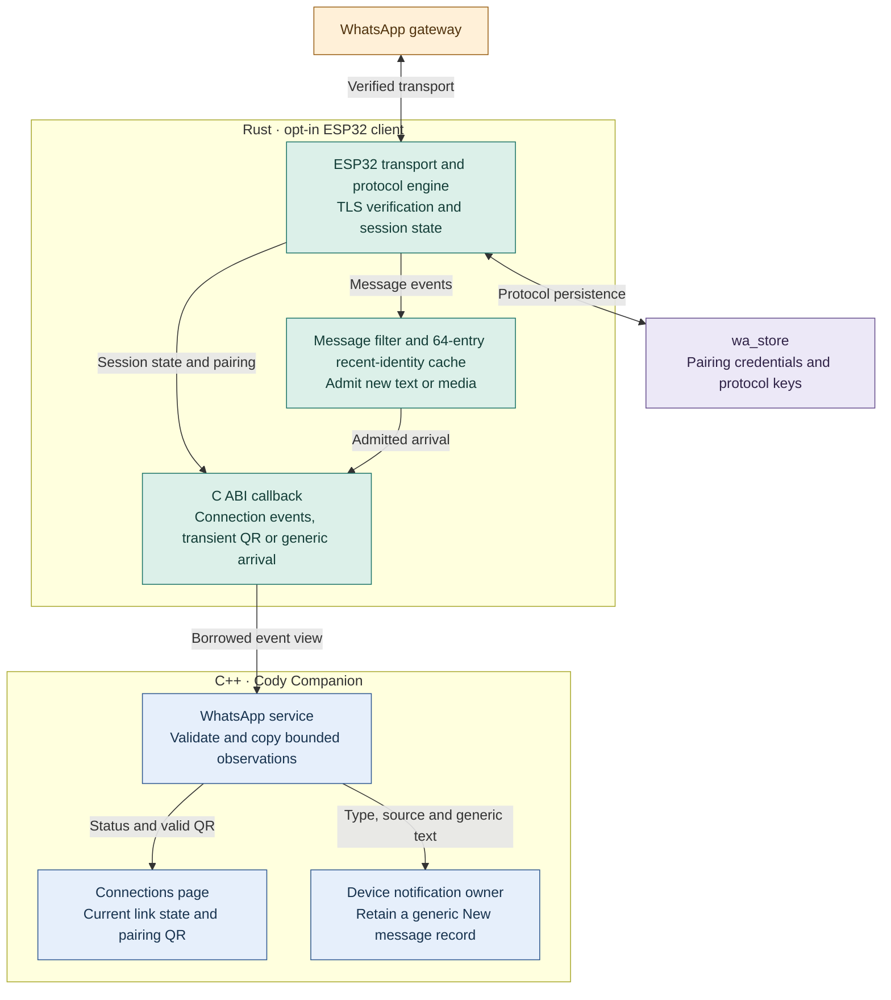

> **File name** `README.md` 
> **Full path** `E:\Cody\esp32-luna-shell\cody-device\experimental\whatsapp\README.md` 
> **Path relative to the repository root** `cody-device/experimental/whatsapp/README.md`

# Experimental WhatsApp client

This opt-in source integration uses the MIT-licensed
[ESP32 platform](https://github.com/oxidezap/whatsapp-rust-esp32) and pinned
[protocol engine](https://github.com/oxidezap/whatsapp-rust). The real gateway
transport and certificate verification are used; the insecure mock server is
not enabled. It is an unofficial client and is not yet a verified Cody feature.

With `LUNASHELL_WHATSAPP_EXPERIMENT=1` in the configure environment, the CMake
component links the Rust owner into the Cody profile. Connections offers a
pairing QR and connection status. The QR is transient; going Back during
pairing requests a graceful stop. A connected session continues after leaving
the page. After restart, the owner attempts to resume a registered session once
Wi-Fi and valid time are available, without initiating a new pairing. A message
notification uses a short original two-note cue through Cody's shared audio
owner, subject to its existing sound and quiet-hours settings.

## Experimental runtime boundaries

The C callback borrows the QR only for the duration of the call. Generic
arrival notices reach the notification owner without sender or message text.

The owner forwards neither sender nor message content to the UI. It excludes
self-sent messages, edits, status and newsletter traffic, and admits only text
and media messages. Its bounded in-memory cache suppresses 64 recent identities
per run; other message types can be missed and old or post-restart replays can
still alert. When the screen cannot present the banner, arrivals are aggregated
until it can. The cue has not been auditioned.

The notification-only configuration does not retain message-specific secrets
for advanced add-ons and does not seed them from history. Encrypted edits, poll
or event changes, and bot replies that need a parent message secret may therefore
be unavailable. Pairing credentials, Signal sessions and other protocol keys
remain owned by the existing persistent store. Other in-memory protocol caches
are not collectively bounded by this setting.

WhatsApp publishes a `Message` to the generic device notification service with
source `WhatsApp`. The provider does not determine its icon: the shared semantic
type does. The service also supports information, questions, success, warnings
and errors from other local integrations. It retains the latest 32 records in
RAM, independently of banner display and sound playback. Each has a stable ID,
monotonic arrival time and read state. Marking a record read preserves it;
consulting the history never requests audio. Pages expose the count of older
records replaced when full. This history survives connection stops and retries
during the same boot, but not a reboot or power loss. It uses no NVS or other
persistent storage and never shares the credential partition. Sender, chat
identity and message body are unavailable in the current WhatsApp notification
API and are not invented by the shared presenter.
`Notifications` merges these records with the authenticated PC events using a
shared type, origin and exact-ID projection. Local records remain openable
without the PC. Their detail uses the shared paginated text presentation and
`Mark as read` changes only the chosen record, retaining it in history. See
[device notifications](../../../docs/cody/notifications.md) for the source
contract and retention limits.

The four partition tables reserve `wa_store` at `0x12000..0x20000`, a 56 KiB
gap in the source layouts, without moving existing partitions. This does not
prove the contents of an actual device. Vendored storage refuses certain
inconsistent or interrupted states instead of erasing or guessing at keys.
Stopping the session requests persistence drains and does not intentionally
revoke the device or format the partition. An NVS partition alone does not
establish encryption at rest.

Upstream recommends a 1 MiB NVS store; the smaller store may fill as Signal
state grows. Capacity, interrupted writes, power loss, flash migration and key
protection require verification before relying on this integration. There is no
guarantee that a particular device has empty space at that address. Never erase
or reformat it to resolve an error without an authorized recovery plan.

The component uses the CMake-first ESP-IDF environment and does not run
`cargo clean`. Its pinned `esp-idf-svc` declares ESP-IDF 6.0 support, whereas
the upstream demonstration targets 6.1. A compatible Xtensa Rust `+esp`
toolchain, Rust sources and adequate ESP-IDF components are required. No
Cargo lockfile, compilation, linking, memory-budget measurement, hardware
pairing or message delivery verification has been performed. The lifetime,
network reconnect and sleep/power behavior also require device validation.
Do not log pairing payloads, keys, messages or contact identifiers.

> **File name** `README.md` 
> **Full path** `E:\Cody\esp32-luna-shell\cody-device\experimental\whatsapp\README.md` 
> **Path relative to the repository root** `cody-device/experimental/whatsapp/README.md`
