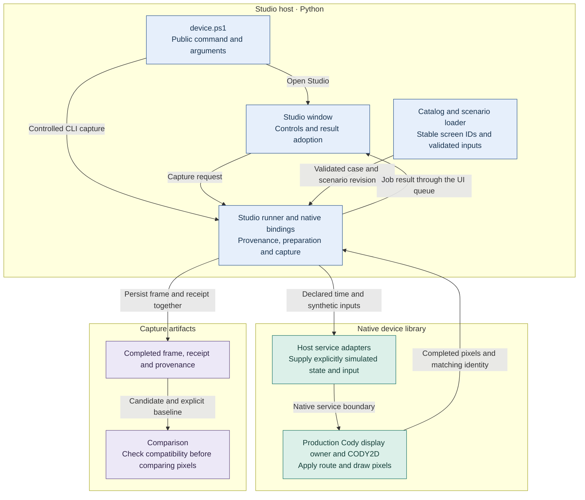
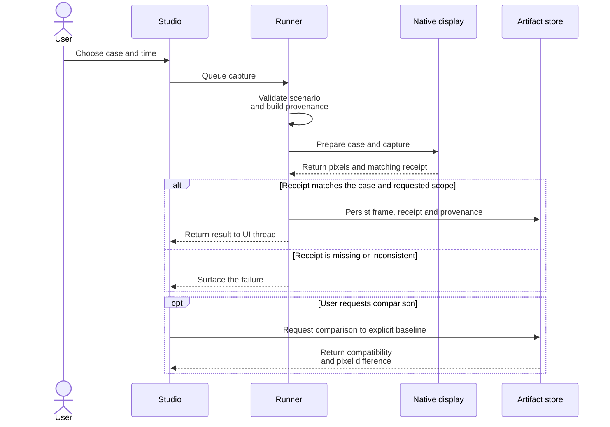

> **File name** `architecture.md` 
> **Full path** `E:\Cody\esp32-luna-shell\cody-device\simulator\windows\architecture.md` 
> **Path relative to the repository root** `cody-device/simulator/windows/architecture.md`

[Desktop simulators](README.md) / Architecture

# Simulator architecture

The live native window and controlled Studio display frames from production
C/C++ renderers. Python supplies host controls, explicit synthetic inputs,
orchestration and inspection. The separate legacy preview also composes host
pages around shared native bindings; its UI behavior is not interchangeable
with the firmware runtime.

## Host orchestration and native rendering

## Follow a controlled capture

1. `scripts/device.ps1` dispatches through `scripts/common/Commands.ps1` to
   `cody_simulator.py` with the selected Studio arguments.
2. `cody_studio_catalog.py` projects source identities from
   [screen-catalog.md](../../../docs/cody/screen-catalog.md) and executable
   contracts from `studio_catalog.json`. Stable source IDs are distinct from
   document-local IDs and firmware enum positions.
3. `cody_studio_scenario.py` validates the explicit scenario against its selected
   contract. It rejects inconsistent inputs instead of repairing them.
4. `cody_studio_runner.py` checks build provenance and coordinates preparation,
   native capture and evidence persistence through `cody_native_device.py`.
5. The native display owner returns completed pixels with their identity.
   Python records the frame and receipt together; it does not infer a screen
   from a delay or reconstruct the device page.
6. `cody_studio_comparison.py` checks compatibility before comparing captures.
   A pixel difference and a human review are separate observations.

The scenario's requested time and the completed-frame time are both recorded
in milliseconds. The native receipt identifies which frame was captured.

## Module responsibilities

| Source | Responsibility |
| --- | --- |
| `cody_native_window.py`, `cody_native_display.py` | Present completed live frames and map host touch coordinates |
| `cody_native_device.py`, `cody_native_runtime.py` | Native device bindings, library loading and runtime entry points |
| `cody_studio_catalog.py`, `studio_catalog.json` | Source projection, executable contracts, variants and declared routes |
| `cody_studio_scenario.py` | Strict controlled scenarios, fixture loading and canonical revisions |
| `cody_studio_runner.py` | Native preparation, provenance, captures and capture loading |
| `cody_studio_window.py` | Tk controls, forms, result adoption and coordination of Studio jobs |
| `cody_studio_preferences.py` | Validated host preferences, atomic replacement and session-long write blocking after storage errors |
| `cody_studio_timeline.py`, `cody_studio_worker.py` | Source samples and isolated controlled display-worker replay |
| `cody_studio_live.py`, `cody_studio_audio.py` | Separate live replay and firmware cue audition processes |
| `cody_studio_atlas.py`, `cody_studio_pdf.py` | Isolated atlas generation, publication and PDF export |
| `cody_studio_comparison.py` | Capture compatibility, immutable baseline copies and review records |
| `runtime_paths.py` | Shared artifact bounds and host-specific library locations |
| `device_model.py`, `fake_device_server.py` | Luna synthetic snapshots, virtual-time actions and HTTP fixture transport |
| `cody_device_ui.py`, `cody_ccp_simulator.py` | Legacy preview presentation and simulated CCP endpoint |
| `../native/` | Host service adapters and native entry points around production code |

## Scenario formats

The `scenarios/` directory contains three different contracts. Choose the loader
through the public command, not by assuming that every JSON fixture is alike.

| Family | Format and loader | Public selection |
| --- | --- | --- |
| Live native device | Snapshot/settings and explicit host-input options; `cody_native_device.py` | `simulator -DeviceScenario <path>` |
| Controlled Studio | `cody.studio.scenario.v1`; `cody_studio_scenario.py` | `simulator -StudioScenario <path>` or `-StudioCase <id>` |
| Luna snapshot simulation | `LUNASHELL.simulator.scenario.v1`; `device_model.py` | `simulator-luna -ToolArguments @('--scenario', '<name>')` or `--scenario-file` |

Controlled Studio uses declared civil time and a bounded timeline. The live
first-boot fixture can explicitly read the PC clock and LAN configuration;
those values remain labelled host inputs. Luna uses a virtual clock and ordered
patches/events. These clocks do not establish physical timing equivalence.

## Ownership and lifetimes

- Tk widgets belong to the main UI thread. Worker results return through queues;
  the window adopts them on its polling callback.
- Controlled captures and live/audio/atlas jobs have different process and
  settings lifetimes. Atlas publication must not prepare the interactive case
  or replace its baseline. Static captures must not open host audio.
- Captures and preserved baselines use unique artifact directories. UI
  preferences retain an explicit baseline reference; an unavailable baseline
  must remain visible until explicitly replaced or cleared.
- Unreadable UI preferences are distinct from a missing file. Their persistence
  owner retains the original failure and blocks writes until a new window loads
  valid or explicitly removed state. Before each save it revalidates the file;
  this is not a multi-writer locking protocol. An independent persistent host
  warning remains visible when acquisition status changes.
- Source execution keeps output under this checkout's `artifacts/`. Shared path
  helpers reject paths escaping that root. Studio runs from source; the Luna
  packaged executable has its own artifact-location policy.
- Cleanup is manual. A new process is required after rebuilding a loaded native
  library; historical captures retain their original provenance.

## Making changes

Add behavior to its existing owner. Device pixels and device policy belong in
production C/C++; synthetic fixtures and inspection belong in Python. Keep
scenario validation, native validation and UI form construction consistent.
Catalog variant metadata alone does not establish complete runner, form and
atlas support for a new variant.

Comment ownership, timing, rejection rules and error propagation at boundaries.
Avoid repeating the implementation line by line. For new or changed functions,
document parameters and exceptions as required by [AGENTS.md](../../../AGENTS.md).
Prefer cohesive modules with explicit inputs over a large collection of mixins
sharing the entire window state.

Use the [check guide](checks.md) and [Studio verification scope](studio.md#verification-scope)
to select focused validation. [TODO.md](../../../TODO.md) owns pending fixes and
acceptance; [done.md](../../../done.md) owns only the latest executed validation.

> **File name** `architecture.md` 
> **Full path** `E:\Cody\esp32-luna-shell\cody-device\simulator\windows\architecture.md` 
> **Path relative to the repository root** `cody-device/simulator/windows/architecture.md`
