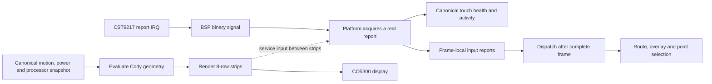

# Cody hardware debug checkpoint

This checkpoint connects Cody's standalone 2D renderer to Luna's existing
CO5300 display and CST9217 touch implementation. It does not add LVGL.
Display and touch remain required. All hardware measurements come through
the canonical device services; the Windows simulator is the only synthetic
input source.

## Touch acquisition and frame ownership

The CST9217 retains Luna's existing 8-bit panel-I/O command configuration,
register-address write, 2 ms settling delay and register read. Its original
configuration sequence and single-contact report format are preserved.
Touch configuration completes before the report interrupt is registered.
The local patch clears old contacts before every read and preserves real
transport, marker and count errors. A successfully read all-zero release
report is decoded explicitly; malformed data is never promoted to success.

The standalone input path uses the same binary interrupt signal as Luna's
input adapter. Its ISR only records the report-ready timestamp and wakes
the consumer. No I2C, drawing or snapshot publication runs in the ISR.



An idle wait ends on the next IRQ or frame deadline. While drawing, the
consumer acquires pending input between strips instead of waiting for the
entire screen. The frame-local buffer holds at most one report per strip;
it preserves acquisition order and timestamps. Reported presses and releases
are dispatched after the frame completes, while its state lock is still held.
This keeps one evaluated geometry and one navigation state per visible frame.

No new report is `ESP_ERR_NOT_FOUND`, with `valid=false` and timestamp zero.
That is not a fabricated release or a failed hardware read. A real failed
read retains its error and attempt timestamp, publishes the failure, and
stops the required consumer. Its log includes IRQ age, read duration and
the physical IRQ level.

## Rotation

Rendering and input retain the shared logical 466 x 466 coordinates and
cardinal transformation, including 180 degrees. The complete frame owns
the display lock. Rotation waits for pending input and an unfinished gesture;
it also rejects a known acquisition error. Checking rotation does not consume
an event intended for Cody and does not manufacture an idle measurement.

The icon-only Back target remains centered at (40, 233), with radius 30,
in the chosen logical orientation. Its full target stays separate from the
central safe square [73, 393) on both axes.

## Measured diagnostics

The rig view includes a small white monospace readout below the safe square:

| Readout | Logical top | Source |
| --- | ---: | --- |
| FPS | 398 | Successfully completed panel frames divided by elapsed time |
| CPU1 / CPU2 | 419 | Measured processor projection of the canonical snapshot |

The 5 x 7 glyph subset uses a 2 x scale, giving 10 x 14 visible glyphs.
The renderer checks the full text box against the narrowest circular chord
it occupies. The CPU row fits even with both values at 100 percent.
The immutable readout is prepared once per frame and drawn across strips.
There is no GUI font engine or per-glyph allocation.

CPU1 labels ESP-IDF core 0; CPU2 labels core 1. The acquisition service uses
blocking IPC to sample each idle runtime counter on its owning core, after
FreeRTOS has accounted for the displaced idle task. Each core has its own
matching timestamp and baseline. Zero intervals, counter inconsistencies
and IPC failures remain errors; values are not clamped or estimated.
The renderer never calls the runtime-counter APIs directly.

FPS starts unavailable until its first complete measurement window and resets
on rig entry/resume. Unavailable, stale or invalid telemetry displays `N/A`.
The requested 33 ms animation schedule is not an FPS measurement.
The three minimal sleeping/waking/ready boot images retain their existing
artwork without diagnostic text.

## Power during this PoC

The Cody build profile disables automatic light sleep during this hardware
debug PoC. Native ESP32-S3 USB Serial/JTAG can disconnect during light sleep;
keeping it awake also retains diagnostic access after a consumer failure.
CPU frequency scaling remains 80 to 240 MHz. Luna's regular UI profiles retain
their existing power policy. This PoC policy is not a battery-life result.

## What remains to assess smoothness

1. Flash the current candidate and confirm that animation keeps running after
   repeated press/release, point selection and motion. A frozen consumer cannot
   provide a useful rendering baseline.
2. Compare breathing, slow/fast contour changes and motion response with the
   skeleton overlay enabled and disabled. Keep the authored geometry, scale and
   palette the same, so the comparison isolates the debug overlay's cost.
3. Measure completed FPS and both real CPU samples. Split frame cost into
   geometry, raster and panel transfer, then examine frame-time variation.
   The current periodic timing log is not a full-frame distribution; median,
   upper-percentile timings and missed deadlines still need that measurement.
4. Check repeated navigation and 180-degree orientation while the animation
   runs, then check the other cardinal rotations. Optimize the measured slow
   stage before expanding the UI or adding integrations.

## Reset from Windows

The existing public action is:

```powershell
pwsh -NoProfile -File scripts/device.ps1 reset -Profile cody-companion -Port COM10
```

It runs the existing esptool chip-identification/reset sequence and does not
erase flash. Its prerequisite is an openable serial transport. The command is
already included in the firmware/device menu.

A Windows PnP device restart is a separate driver/device operation, not a
guaranteed electrical reset. The narrowly targeted attempt against this
board's exact USB instance was rejected with `Access denied` in the current
non-administrator session. No verified USB-restart command has been added to
the public console.

## Evidence and limits, 2026-10-03

All compilation, flash and capture attempts used `scripts/device.ps1`.
The current working firmware compiled successfully with ESP-IDF 6.0.2 and
at most eight compiler jobs. Its image is 0x18eab0 bytes, with 89 percent of
the application partition free. The build included the other ongoing review's
unstaged integration changes; it was not an isolated-commit build.

The last successful flash predates the final Luna transport/IRQ changes.
Its capture at
`artifacts/build-cody-companion/device-evidence/boot-touch-atomic-hud.log`
records boot completion at 3.894 s, absent battery with cell data unavailable,
and valid measured CPU samples throughout the capture. The same image still
stops on an invalid touch report. Earlier captures measured approximately
6 FPS with the skeleton overlay before the freeze; that is not a performance
result for the newest candidate.

The latest transport/IRQ and awake-policy candidate has compiled, but USB
became non-openable before flashing. Its touch responsiveness, continuous
animation, physical HUD placement and 0/90/180/270 alignment remain unverified.
The user was away from the PC, so no new manual gesture evidence was obtained.
Shared CPU and standalone touch corrections were ported to Luna in separate
commits; no Luna build or hardware operation ran for those ports.
Host/simulator tests and the complete final validation package were not run.
The subsequent `device.ps1 reset` attempt also failed before opening COM10,
although Windows listed the port as present. The PnP restart was denied as
described above; neither attempt reset the board.

## Subsequent device checkpoint (2026-10-03)

USB recovered and the newer standalone firmware was built/flashed successfully.
The user confirmed continuous animation and tap response. Serial captures record
the three boot artwork transfers, both successful codec cue writes, live IMU/audio
observations and absent battery with charge data explicitly unavailable. This
supersedes the earlier USB-blocked state above, not its historical evidence.

The initial working animation showed about 11 FPS without the skeleton. Further
cache/DMA/stroke optimization and CPU timing evidence is maintained in
[Cody rendering performance](cody-render-performance.md). This does not establish
audio quality, cardinal touch/rotation stress, battery interaction or long-run
stability. The integrated hardware builds still contain the parallel review's
unstaged changes; focused performance commits preserve that work separately.

Copyright umbertogiacobbi.biz 2026 - confidential
