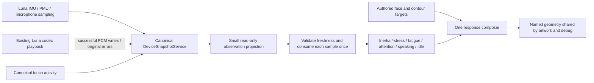

# Cody offline PoC: demo, observations, audio and profiling

Copyright umbertogiacobbi.biz 2026 - confidential

This checkpoint prepares the next hardware test. It does not establish device
fluidity, audio quality, DMA reliability or touch behavior on the board.

## Configuration and startup

`assets/cody/poc.yaml` owns the automatic demo, diagnostic flags, frame target
and two distinct boot cues. `assets/cody/cody.yaml` owns the character, shared
256-slot palette references, response gains and idle behavior. Both documents
reject duplicate keys and invalid settings. Generated tables and core PCM assets
live in internal firmware flash; an SD card is not needed to draw or play Cody.

The startup owner registers a short original **audio-ready** cue before hardware
initialization. Luna plays it immediately after configuring its existing codec
route. The sleeping and half-awake artworks still mark real startup stages.
After the mandatory stages, the ready artwork completes its transfer; the demo
starts and the original **eyes-open** strings crescendo plays through the same
Luna playback API. Cue durations are 0.18 seconds and 1.30 seconds of PCM,
respectively; codec settling time adds latency. The two sounds are procedural
originals, not imported recordings. WAV copies are available for host listening.

The authored 29-second cycle exercises breathing, slow contour waves, fast
contour waves, sleepy eyes and awake eyes. Face and contour transitions retain
their existing continuous interpolation. Firmware demo targets are artwork
controls; they never manufacture sensor observations. Back returns to the ready
artwork and remains a chevron in the left circular margin. Overlay toggle retains
its right-margin target. Display, clipping and hit testing share cardinal rotation.

## One snapshot, composable effects



Charge affects fatigue only when a successful current battery sample exists.
Absent/failed/stale charge freezes the artistic fatigue level and stays explicitly
unavailable; charging alone does not invent recovery. Microphone input uses the
actual per-channel PCM16 absolute mean and peak published by Luna. Playback
publishes an absolute mean only after a successful codec write, with its own
status/timestamp. Failed operations retain their original errors. Stale audio
contributions decay; this is artistic state decay, not a silent sensor reading.
Playback suppresses the microphone's attention contribution to avoid responding
to Cody's own cue while preserving the microphone measurement itself.

After 20 active seconds without touch, significant motion stress, microphone
activity or confirmed playback, a 3.2-second yawn gradually opens the mouth and
closes the eyelids. It has a 40-second cooldown. These values and output gains
are configurable under `response.idle`. Activity interrupts the yawn with a
smooth release. Parked time does not advance the idle, yawn, breath or blink clock.

A tap on either eye uses its displayed named anchor and a normalized hit radius
scaled with the evaluated character. The canonical snapshot receives that real
semantic touch event and its original timestamp. The model consumes it once,
briefly closes both eyes, raises the brows with an annoyance contribution and
adds stress; closure and annoyance then recover smoothly. Repeated taps restart
the response, but re-rendering one published tap does not. Touch gains and durations
live under `response.touch` in the strict `cody.response.v3` authoring contract.
The same hit test and response are available in the Windows preview at every rotation.

The Windows Stimuli tab includes visibly synthetic battery presence/charge,
two microphone levels, playback activity/level, source health and explicit
interaction. The Face tab can run the same authored demo. Preview-cue buttons
play local WAV files, separately from the explicitly synthetic playback sliders.
No host fixture or synthetic observation can enter a firmware snapshot.

## Profiling and SD ownership

`diagnostics.execution_timings` enables console timing logs. Boot logs include
real stage and cumulative durations from PoC registration onwards. Completed
boot-buffer logs and animation frames split geometry, raster and panel transfer.
Animation summaries retain up to 128 actual completed frames **per overlay mode**:
mean stage/total cost, lower middle median, nearest-rank P95, maximum, population
standard deviation and count exceeding the configured target frame budget.
The 33,333-us target is a budget, not a measured FPS claim. FPS and both CPU
readouts continue to use their measured snapshot-backed sources.

Logs are printed after releasing the frame/state lock. Partial frames do not
enter successful-frame statistics. Entry/resume resets the bounded windows;
overlay changes keep separate windows. The collector allocates no frame-time
heap memory. The transfer deadline and DMA retirement/quarantine remain owned
by the standalone display service.

`diagnostics.mirror_to_sd_when_available` uses the existing Luna logger mirror
only when the canonical storage snapshot reports a mounted, healthy, verified
card. It never mounts or formats a card and never substitutes internal storage
for SD. The current Cody profile keeps SD disabled, so console remains the active
sink. Logs before the SD mirror becomes available remain console-only. Profile
selection, card mounting and any storage error keep their existing owners.

## Offline check entrypoints

All commands use `scripts/device.ps1`; firmware/hardware validation is separate.
Native checks accept an existing host Clang, GCC or MSVC driver. Select a host
compiler; Espressif's installed Clang defaults to embedded RISC-V and does not
produce an executable Windows test. For MSVC, enter its Developer PowerShell
environment before invoking the same console commands.

```powershell
./scripts/device.ps1 generate -Generator cody-rig
./scripts/device.ps1 generate -Generator cody-poc
./scripts/device.ps1 check -Check cody-response
./scripts/device.ps1 check -Check cody-poc
./scripts/device.ps1 check -Check cody-native -ToolArguments @('--compiler', '<host C++ compiler path>')
./scripts/device.ps1 check -Check cody-runtime -ToolArguments @('--compiler', '<host C++ compiler path>')
```

Native checks compile the real portable rig/raster and response/demo/benchmark
code for the host. The runtime fixture covers 50 seconds of audio, low charge,
absent charge, idle yawn and interruption, comparing native and Python results.
This does not compile the ESP-IDF driver integration or validate a physical
microphone, speaker, SD card, touch panel, USB recovery or firmware stack margin.

Pending on the board: new firmware compile/flash, all three boot artworks and two
audio cues, continuous demo, repeated touch release, 0/90/180/270 mapping, measured
frame distributions with overlays off/on, stack high-water marks, radio headroom,
and real battery/microphone/playback responsiveness.

## Host evidence (2026-10-03)

The explicitly authorized offline checks passed in the integrated working copy:

| Console check | Result | Scope |
| --- | --- | --- |
| `cody-response` | 11 tests passed | Motion, power, aging and model contracts |
| `cody-poc` | 23 tests passed | Palette, geometry, face/contour transitions, alpha, Tk resizing, labels, navigation and cardinal rotation |
| `cody-native` | Passed | Actual portable C++ raster/rig, RGB565 alpha, stride guards, rejection, culling/strip parity and native/host named geometry |
| `cody-runtime` | Passed | 500 native/host response updates over 50 fixture seconds, audio, unknown charge, yawn/cancellation, eye-tap closure/annoyance, original cue assets, demo boundaries and rolling statistics |

The C++ host checks used installed MSVC 14.51 in its x64 developer environment.
Their final compilation emitted no warnings. An earlier run exposed unsigned
negation in the playback contribution; the source now converts the PCM mean to
float before applying the negative gain. The Tk resize fixture also now drains
Windows configure events before checking the presented layout; its original
geometry and label assertions remain intact.

Reports are under `artifacts/cody-poc/host-review.json`,
`artifacts/checks/cody-native/report.json` and
`artifacts/checks/cody-runtime/report.json`. No ESP-IDF configure/build/size,
serial access, flash, SD access or physical hardware validation ran in this
offline checkpoint. Hardware frame costs and fluidity remain unmeasured.

Checkpoint commits keep the pre-existing display/DMA/module refactors separate.
The portable raster check also exercised that pending work in the integrated
working copy; it does not imply those unrelated changes were included in Cody's
feature commits.
