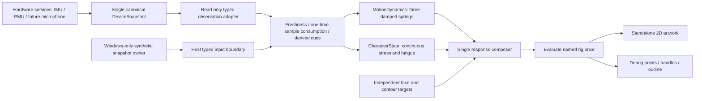

# Cody Response Engine

Copyright umbertogiacobbi.biz 2026 - confidential

Implementation checkpoint for the first hardware test release. The native engine,
snapshot adapter, YAML configuration and Windows controls are implemented.
Firmware tables were regenerated from source. Runtime, simulator and hardware
validation are deferred until explicitly requested.



## Ownership and input contract

Luna services remain the sole hardware samplers and publish into the existing
`DeviceSnapshotService`. Cody does not refresh hardware, start a competing
sampler, or keep another measurement cache. `readMotionPowerObservation()` copies
the required fields under one lock from the canonical snapshot. This smaller
view avoids putting the complete audio/storage inventory on the renderer stack;
it has the same publication, aging and error ownership as `snapshot()`.

| Typed source | Unit and reference frame | Current sample requirements |
| --- | --- | --- |
| `motion.acceleration` | m/s2, named board X/Y/Z axes, including gravity | Ready IMU, valid data, successful read, positive timestamp and no stale flag |
| `power.charge` | 0-100 percent | Ready battery, present cell, valid percentage, successful read and no stale flag |

Every input carries its original error, successful sample timestamp and explicit
`CURRENT`, `STALE`, `ERROR` or `UNAVAILABLE` status. Freshness also uses a
source-specific maximum age. A current nonfinite/out-of-range value, a future or
reversed timestamp, an ambiguous axis mapping, or invalid authoring fails visibly.
An unavailable source is optional for the animation and remains unavailable in
the model/readouts; processing its status does not claim that the read succeeded.

Only the Windows simulator has a synthetic snapshot owner. Its controls,
readouts and captures say `SYNTHETIC`. Firmware input origin is hardware-only.
Configuration is in `assets/cody/cody.yaml`, under `response`; named fields,
source identities, units, signed axis permutations and parameter bounds are
validated before generation. Native and host numeric limits share that source.

## Motion and inertia

The first successful acceleration sample primes a slowly changing baseline.
Later **new timestamps** update that baseline and the derived transient cue.
Rendering the same publication again does not filter or inject the sample again.
The bounded artistic cue drives the springs between observations; it is not
republished as a fresh sensor measurement. Missing/stale input removes new drive
and disarms the baseline. The next fresh sample primes it again, preventing a
manufactured recovery impulse. Standby also discards that input history.

This is a high-pass motion cue, **not validated gravity-free linear acceleration**.
Slow tilts and abrupt changes in gravity direction can influence it. Sensor
fusion currently does not supply a validated gravity vector for subtraction.

X and Y drive opposing translation; Z drives a small uniform depth scale. The
character stays front-facing. Each spring retains displacement and velocity.
An analytical second-order solution supports underdamped, critically damped and
overdamped settings with bounded work per frame, without a catch-up loop or
per-frame native allocation. Output saturation bounds the artistic excursion;
raw observed acceleration is never silently clamped.

The signed `board_to_panel` map is authored explicitly. Its initial identity map
must be checked against the real board mounting. Springs remain in the physical
panel frame. The composer applies the inverse 0/90/180/270 vector rotation; the
display applies its presentation rotation once. Rotation never restarts a
spring. Root position and scale transform every anchor, lobe, eye, nose, cheek,
mouth and Bézier handle together. Navigation and the layout guide remain fixed.

## Continuous internal state and expression

`stress` and `fatigue` are normalized **artistic model values**, not measured
emotions, health or battery telemetry. They are not exclusive face poses.

Motion magnitude drives stress with a fast attack and slower release. Battery
percentage drives `fatigue_target = (1 - percentage / 100)^fatigue_curve`, with
separate smooth attack/recovery constants. Charging does not instantly reset
fatigue: the valid charge level must improve. If charge becomes unknown, fatigue
holds its last artistic state and the source says unavailable/stale/error.
Before a valid percentage has ever arrived, fatigue is explicitly unknown.

The single composer combines these contributions with existing face controls:

| Contribution | Effects |
| --- | --- |
| Stress | Raised brows, more open/narrower mouth, stronger/faster contour waves, faster breathing |
| Fatigue | Heavier eyelids, faded cheeks, reduced fullness, slower contour and breathing |
| Existing controls | Independent mouth width, nose size, cheek size/opacity, face presets and authored contour targets |

Face transitions and contour transitions remain separate. Breath uses an
integrated, smoothed frequency rather than `elapsed * new_frequency`. Blink has
its own clock. Changing a target, charge level or sensitivity preserves phases.
Paused/hidden animation excludes its elapsed time. An explicit simulator
`Reset response model` action may reset the model; changing a preset does not.

## Windows controls and debug

The `Stimuli` tab exposes board X/Y/Z offsets, overall sensitivity, an axis
selector with a short pulse, continuous shake, charge percentage, charging and
independent source-health selectors. The synthetic source publishes the latest
sample on a nominal 50 Hz timeline; a slow frame does not manufacture missed
samples. Timing remains a measured host frame time, with ESP32 performance
labelled unmeasured.

Readouts show source status/error, valid current values, model stress/fatigue,
logical root offset, unsaturated spring velocity and depth scale. The optional
debug overlay shows an amber resting-root cross, mint current-root circle and
the displacement vector. Existing names and point selection use the evaluated
scene, including the root transform. Controls reuse the responsive, scrollable
tab layout and the shared slider helper.

The native debug route remains accessible by touching the completed boot image.
It consumes real canonical observations and logs source-health transitions,
model values and existing measured geometry/raster/transfer times. The three
immutable sleeping/waking/ready boot images keep their real startup checkpoints.

## Blueprint for subsequent inputs

For a microphone or gyroscope, add a typed source with a stable namespace ID,
unit, timestamp, validity and original error to the canonical snapshot adapter.
Consume new samples once, derive only justified features, and add continuous
state/effect contributions before the existing composer. Do not add direct
device reads, a parallel snapshot, or whole-face enums.

Future microphone level/onset could affect attention or surprise; a level alone
does not prove detected speech. Gyroscope effects would need an explicit angular
reference frame and the same root-transform/rotation policy. These extensions
are architectural seams, not implemented features in this checkpoint.

## Validation to request before a hardware release

Prepared focused host checks are available through the existing console:

```powershell
./scripts/device.ps1 check -Check cody-response
./scripts/device.ps1 check -Check cody-poc
./scripts/device.ps1 simulator
```

The response check covers gravity priming, all axes, duplicate timestamps,
analytical spring subdivision, unavailable/stale recovery, charge monotonicity,
unknown battery, charging independence, all-point root transforms, cardinal
rotation, channel composition, paused phases and rejected input/configuration.
It is prepared and has not been executed.

On an explicit final validation request, complete the repository validation
package and native/host comparison before device work. Separately authorized
hardware work must verify board-axis signs, actual IMU publication cadence and
warm-up, 180-degree rotation/touch, standby/wake, three boot checkpoints, frame
geometry/raster/transfer cost with overlays on/off, stack headroom and Wi-Fi/BLE
coexistence. Record measured behavior before tuning YAML gains or declaring
smoothness on ESP32. Flash, serial capture and monitoring remain separate
authorized operations through `scripts/device.ps1`.
