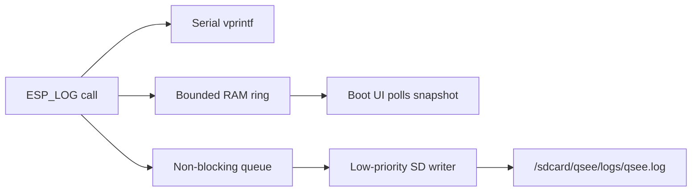
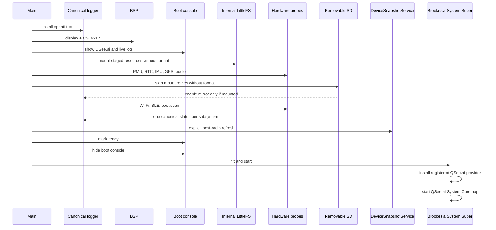

# Startup and canonical logger

The logger is installed as the first application action. Its callback never
touches LVGL or the filesystem.

The SD writer starts with the logger but does not consume queued lines until a
card has mounted successfully. Queue overflow drops only the SD copy; serial
and the newest RAM lines remain available.

## Boot sequence

All optional hardware probes are fail-open. A missing SD card, GPS fix, IMU, or
radio does not prevent the UI from becoming usable.

## Brookesia application boundary

System Super owns the system lifecycle and services. System Core discovers the
registered QSee.ai provider, creates its native `IApp`, and drives its
start/stop/action/timer callbacks. GUI LVGL loads the app document from
`/littlefs/ai.qsee.device-console/res/root.json` and renders its
`qsee_content` screen flow.

The JSON package contains view structure, layout, styles, and action names.
The native app binds values through the GUI interface. It reads hardware
telemetry only from `DeviceSnapshotService`; the Logs screen reads only the
canonical logger ring. Search uses the System Super keyboard service, and SD
formatting uses the System Super message-dialog service.

## Storage separation

`/littlefs` is an internal flash volume containing staged Brookesia and QSee.ai
application resources. It is mounted with formatting disabled. `/sdcard` is
the removable FAT volume used for the mirrored canonical log and user data.
Neither volume is used as a fallback for the other.

Ordinary SD detection and mount retries never format the card. A format attempt
can be armed only when `DeviceSnapshotService` reports a responding card whose
FAT mount requires formatting and the user accepts the destructive
confirmation. Cancelling the dialog performs no storage write.
