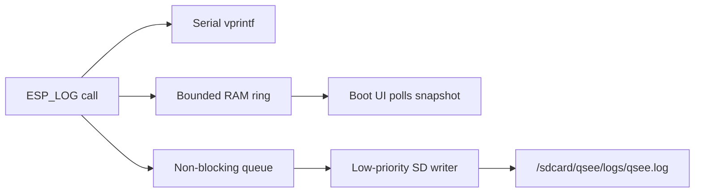
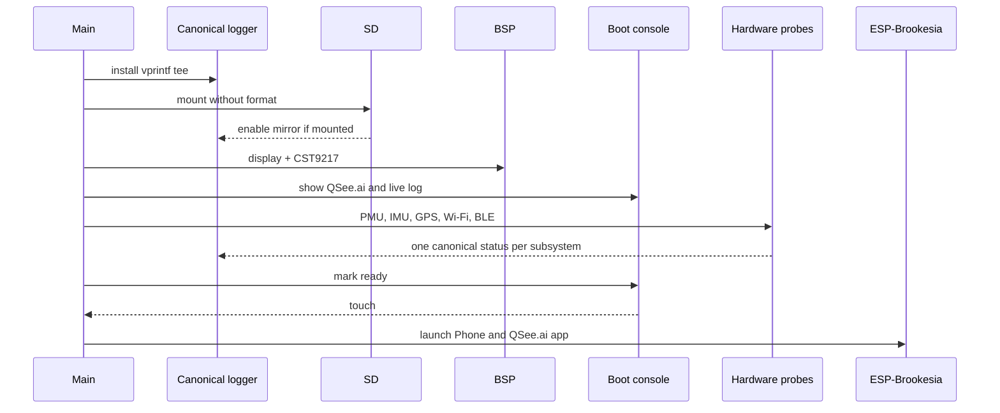

# Startup and canonical logger

The logger is installed as the first application action. Its callback never
touches LVGL or the filesystem.

The SD writer starts with the logger but does not consume queued lines until a
card has mounted successfully. Queue overflow drops only the SD copy; serial
and the newest RAM lines remain available.

## Boot sequence

All optional hardware probes are fail-open. A missing SD card, GPS fix, IMU, or
radio does not prevent the UI from becoming usable.
