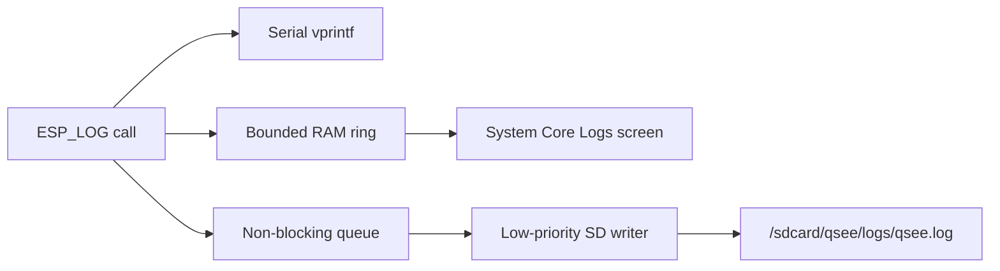
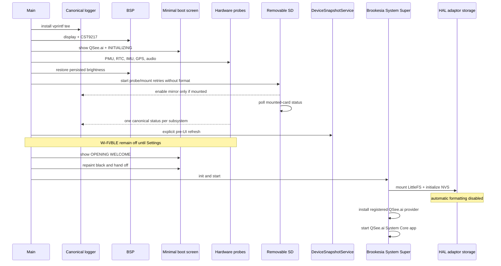

# Startup and canonical logger

The logger is installed as the first application action. Its callback never
touches LVGL or the filesystem.

The SD writer starts with the logger but does not consume queued lines until a
card has mounted successfully. Queue overflow drops only the SD copy; serial
and the newest RAM lines remain available.

## Boot sequence

`qsee_hardware_init()` runs PMU, RTC, IMU, GPS, and audio initialization in a
fixed order and returns at its first failed stage. The main orchestrator
explicitly allows hardware inventory, time, power inputs, boot audio, removable
storage, and the pre-UI refresh to fail while continuing to the UI; their real
errors remain in the logger and `DeviceSnapshotService`. Touch unavailability
is also reported without stopping the handoff.

Logger installation, display startup, the boot screen, persisted brightness,
and the ready/handoff transition are required and stop `app_main()` on failure.
A later System Super or QSee.ai app launch failure ends the Brookesia launch
task while leaving the canonical logger active. No failure is converted to
success, and ambiguous recovery stops the failing stage.

## Brookesia application boundary

System Super owns the system lifecycle and services. System Core discovers the
registered QSee.ai provider, creates its native `IApp`, and drives its
start/stop/action/timer callbacks. GUI LVGL loads the app document from
`/littlefs/ai.qsee.device-console/res/root.json` and renders its
`qsee_content` screen flow.

The JSON package contains view structure, layout, styles, and action names.
The native app binds values through the GUI interface. It reads hardware
telemetry only from `DeviceSnapshotService`; the Logs screen reads only the
canonical logger ring. Search uses the System Super keyboard service, and SD
formatting uses the System Super message-dialog service. The seventh screen,
Settings, owns the explicit radio-start action and persisted display/device
preferences.

## Storage separation

`/littlefs` is an internal flash volume containing staged Brookesia and QSee.ai
application resources. The official Brookesia HAL adaptor mounts it and
provides the NVS-backed key-value interface, with mount-time formatting
disabled. `/sdcard` is the removable FAT volume owned by QSee for the mirrored
canonical log and user data. The HAL adaptor's SD-card backend stays disabled;
neither volume is used as a fallback for the other.

The board has no SD card-detect pin, so a failed SDMMC probe is reported as
`card/transport unconfirmed`, never as confirmed physical absence. Only
explicit transient card/transport and filesystem failures are retried, and
those probes never format the card. `format-required` is published only after
card initialization and an exact `FR_NO_FILESYSTEM` result; probing then pauses
until a matching explicit authorization arrives.

The destructive dialog can authorize one immediate retry only. That permission
is bound to all observed CID fields plus capacity and is consumed even if the
card changes, disappears, fails transport, or no longer needs formatting.
Cancelling the dialog performs no storage write. After a successful mount, the
storage task polls card status; removal or transport failure invalidates and
unmounts the volume before retrying. Internal, destructive, poisoned, or
incompletely cleaned failures stop retries for the current boot and remain
visible as terminal cleanup/ownership errors.
