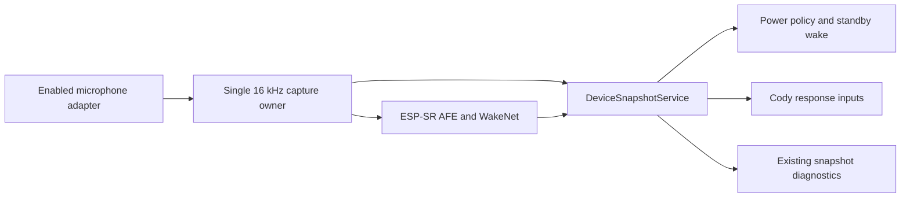

# Optional wake-on-word

The shared Luna platform can recognize **Sophia** locally with ESP-SR 2.4.6
and `wn9_sophia_tts_v1`. The current trial has exactly one behavioral consumer:
the power owner wakes a settled software standby. Active-device detections
remain diagnostic events and do not change display policy, activity timers,
Cody idle state or animations. Recording, transcription and host delivery
are outside this trial.
The model does not recognize **Cody**, transcribe speech or accept commands.

## Build selection and hardware capabilities

Ordinary firmware variants retain their existing defaults with wake word off.
Use `-Feature wake-word` with `-Profile cody-companion` or `-Profile full` through
`scripts/device.ps1`. Each variant has an isolated SDK configuration, build
folder and canonical dependency lock. Other profile/feature combinations fail
at the catalog boundary instead of silently selecting another product.

The requested voice selection is wake-on-word with local synthesis disabled.
The wake-word defaults explicitly exclude `LUNASHELL_BUILD_ENABLE_TTS` and the
Italian synthesized boot test; the public feature gate also rejects a TTS
component/backend in this variant. Existing SD contents are not installed,
rewritten or removed by selecting this firmware variant. The reviewed Sophia
recognition weights live in the internal model partition. The `_tts_` substring
in their upstream model name does not enable the local speech synthesizer.
Prerecorded audio and synthesis are separate paths. The audio owner converts
the 22.05 kHz boot chime/greeting to the fixed 16 kHz duplex transport in bounded
chunks, preserving its source asset and duration. Speaker and AEC receive the
same converted samples. The sole AFE capture owner reads the prepared RX codec
independently of the TX playback mutex, so clips and their DMA retirement waits
cannot starve inference. Acknowledged AFE pause precedes stream closure;
diagnostic PCM capture is rejected while AFE owns the microphone.

`CONFIG_LUNASHELL_BUILD_ENABLE_WAKE_WORD` is the sole public engine gate;
`LUNASHELL_BUILD_ENABLE_VOICE_AFE` is hidden and derived from it. Disable the
feature with `-Feature none` (also the CLI default). The disabled variant
excludes ESP-SR and its private DSP dependencies, AFE source and stubs, worker
tasks/buffers, speaker-reference hooks, diagnostic handoffs and voice publication
entrypoints. Its canonical snapshot retains the stable `Disabled` voice schema.
No model directory is inspected or packed and no flash space is reserved for it.

`scripts/common/WakeWord.ps1` gates catalog roots, generated configuration,
partition selection, resolved locks, model inventory/provenance and flash image
admission. The firmware wrapper generates a feature-specific defaults overlay
under `artifacts/feature-config/`; feature-off selects `partitions.csv`, feature-on
selects `config/partitions/wake-word.csv`. CMake enforces the same selector and
layout contracts, including the actual component closure. Partition-table content
is included in the build-state fingerprint. Incompatible cached configuration
is rejected and requires an explicit configuration action; it is not repaired
silently. Flash refuses a missing or unselected `srmodels.bin` before serial I/O.

`CONFIG_LUNASHELL_BUILD_ENABLE_WAKE_WORD` is available only when both
`LUNASHELL_BUILD_VOICE_ENGINE_AVAILABLE` and
`LUNASHELL_BUILD_VOICE_CAPTURE_AVAILABLE` are true. Enabling the feature
selects the dedicated AFE, without selecting audio or a disabled codec behind
the hardware configuration's back.

The reviewed engine capability is ESP32-S3 with PSRAM enabled. The reviewed
capture capability requires enabled audio, enabled ES7210 codec support and
a selected ES7210 mono or dual input adapter. CPU model and audio adapter are
separate decisions; neither capability depends on a product/board name.
The current standby trial also requires the power owner and dual-core operation.
`LUNASHELL_BUILD_VOICE_MICROPHONE_CHANNELS` declares the adapter topology and
startup checks the actual driver's channel count before admitting capture.

| Enabled input | Enabled output | AFE layout | AEC |
| --- | --- | --- | --- |
| One microphone | ES8311 | `MR` | Speaker PCM reference |
| Two microphones | ES8311 | `MMNR` | Speaker PCM reference |
| One microphone | None | `M` | Disabled |
| Two microphones | None | `MM` | Disabled |
| None / disabled codec / unsupported CPU / no PSRAM | Any | Feature unavailable | No voice worker |

`N` is an unused ESP-SR input slot. `R` contains successfully written 16 kHz
speaker samples, or silence while there is no playback. These internal AFE
inputs are never published as sensor measurements. Cody's scene/touch assets
use 16 kHz; its boot chime/greeting is authored at 22.05 kHz and converted by
the audio owner when the fixed voice transport is selected.

## Model storage and identity

The official, unmodified model is versioned under `assets/wake-word/models/`.
Its source is pinned to the ESP-SR 2.4.6 source snapshot, with SHA-256 provenance
and the original ESPRESSIF MIT License in the parent folder. The feature's
partition table reserves 512 KiB for the internal `model` partition. It reduces
the factory application from 14,476 KiB to 13,964 KiB and leaves the existing
NVS, PHY and LittleFS placements unchanged. The packed image must be included
in the authorized firmware flash; an application-only update cannot install
the new partition contents.

The wrapper writes the checkout's absolute external-model path to a generated
defaults overlay under `artifacts/feature-config/`, so spaces and different worktree
locations do not become hardcoded source paths. ESP-SR builds `srmodels.bin`
and adds it to the normal flash target. Stock WakeNet/MultiNet/NSNet/VadNet
model selections must remain off; WebRTC NS/VAD add no model assets. Replacing
weights requires an authorized clean feature build because the upstream
packer tracks sdkconfig rather than every external weight file.

Startup admits exactly one model with the exact name `wn9_sophia_tts_v1` and
wake-word metadata `Sophia`. Missing/extra/incorrect models fail initialization
and publish the original error. ESP-SR's one-based model and word indices are
checked only at its API boundary, then mapped to `WakeWordId::Sophia`. Domain
consumers never infer identity from array order. Detection events carry an
original timestamp and a monotonically increasing sequence; a 1.5-second
cooldown rejects repeated detections from the same utterance.

## Acquisition and publication



The feed task publishes real per-channel PCM mean/peak levels and the original
capture completion timestamp. Full snapshot and ordinary diagnostics reuse
those canonical measurements while the AFE owns capture, without reopening
the microphone or inventing another sampling time. Spectrum diagnostics keep
the existing explicit exclusive lease; recognition is paused during that lease.

`DeviceSnapshot.voice` exposes `Disabled`, `Starting`, `Listening`, `Paused`
and `Failed`, with health, validity, the real error, configured model, detected
word, event sequence and historical detection time. Listening heartbeats age
after one second independently of the sensor diagnostic cadence. The last
event time is preserved across pauses and failures; it is not a fresh reading.
HTTP snapshot/status diagnostics expose this data when HTTP is compiled.

Capture/inference errors stop recognition and publish failed state. Workers
use a one-shot startup gate; partial task creation releases model resources
only when no live task can still own them. Suspend waits for both feed and
fetch acknowledgment before changing the route; resume clears old inference
and speaker-reference buffers before admitting capture. A terminal failure
wins over an inference result already in flight. Runtime restart/repair is
not attempted silently; the failed component remains visible.

## Native acceleration and SIMD

`LUNASHELL_task_affinity.hpp` assigns voice to CPU0 and native Cody rendering to
CPU1. Both authored feed/fetch tasks use `xTaskCreateStaticPinnedToCore`; the
ESP-SR configuration also explicitly sets `afe_perferred_core` to CPU0 for its
internally created processing task. Leaving either layer unpinned would allow
recognition work to share the renderer's CPU. Full Luna wake-word builds select
the official Brookesia LVGL display adapter on CPU1 and one software draw unit,
so additional unpinned LVGL raster workers are not admitted. Startup logs the
configured voice core. These are source-level scheduling constraints, not
measured runtime latency, CPU load or memory-bus isolation.

### PSRAM allocation policy

Wake-word defaults explicitly require initialized PSRAM, malloc integration,
external BSS and `CONFIG_FREERTOS_TASK_CREATE_ALLOW_EXT_MEM`. ESP-IDF 6.0.2
already defaults that last option on for ESP32-S3; the feature pins it rather
than relying on an inherited default. Both CMake and the public CLI reject
configurations that omit these capabilities, prefer internal ordinary heap
allocations, or reserve less than 64 KiB for internal-only allocations.

Microphone input, interleaved AFE feed and the 8,000-frame AEC reference ring
use aligned `MALLOC_CAP_SPIRAM | MALLOC_CAP_8BIT` allocations. Feed/fetch stacks
also require PSRAM, with explicit 4,096/3,072-byte sizes; these application
allocations fail with their original memory error instead of retrying in
internal RAM. ESP-SR uses `AFE_MEMORY_ALLOC_MORE_PSRAM`, its most
PSRAM-oriented documented mode, while retaining ownership of its opaque
inference resources and any internal-only allocations.

External BSS also holds the typewriter and
personality playback stacks (4,096 bytes each), shared playback PCM staging
(2,400 bytes), and diagnostic microphone PCM (2,048 bytes). This moves
12,640 bytes of authored storage out of internal BSS for the supported audio
profile. Main independently enables these shared audio placements for ordinary
profiles too; the merged policies do not add the same saving twice. This is a
source-size budget, not a measured heap saving. Blocking
I2S reads/writes copy these application PCM buffers to/from driver-owned DMA
buffers. Playback workers do not perform flash writes. Scheduler TCBs,
semaphores, critical-section mailboxes and DMA descriptors remain internal.
Read-only graphics/audio stay flash-backed; the policy does not enable a
blanket read-only-data copy to PSRAM. The model remains stored in internal
flash, with runtime weight placement owned by ESP-SR. Disabling WoW removes
its AFE buffers/stacks while preserving the shared audio PSRAM placement
introduced independently on main.

The policy follows the pinned [IDF 6.0.2 external RAM constraints](https://github.com/espressif/esp-idf/blob/v6.0.2/docs/en/api-guides/external-ram.rst)
and [ESP-SR 2.4.6 allocation modes](https://github.com/espressif/esp-sr/blob/cfdbb52172d4f1b3e5f7469d6c3c6e5dd0738143/include/esp32s3/esp_afe_config.h).
Compilation, linker placement, external-stack call paths and runtime memory
headroom still require explicitly authorized validation.

Inference and AFE processing are delegated to ESP-SR's target-specific
ESP32-S3 native libraries (`libwakenet`, `libesp_audio_front_end` and their
native DSP/neural kernels). The [ESP32-S3 technical reference](https://www.espressif.com/sites/default/files/documentation/esp32-s3_technical_reference_manual_en.pdf)
documents its SIMD instruction extensions; [Espressif's AI solution guide](https://docs.espressif.com/projects/esp-techpedia/en/latest/esp-friends/solution-introduction/ai/ai-solution.html)
describes AFE optimization for the S3 accelerator. The feature integrates
that vendor engine rather than reimplementing its neural inference.

This change adds no authored assembly. The microphone mean/peak statistics
and buffer interleaving are readable C++ loops over real 16 kHz blocks, using
startup-allocated, 16-byte-aligned buffers. Compiler optimization alone is
not evidence that those loops use the proprietary SIMD instructions. The
exact linked instruction path, our loop overhead, total recognition cost and
any value from an additional assembly kernel remain unmeasured until an
explicitly authorized build/disassembly and device performance review.
Future processors require their own reviewed engine capability and vendor
kernels; display shape never selects an instruction set.

## Software standby

With `CONFIG_LUNASHELL_BUILD_WAKE_WORD_STANDBY_LISTENING=y`, software standby
turns off the screen and applies other existing standby policies while leaving
the voice worker and shared audio transport active. The power owner's resource
consistency checks use this explicit audio target. Fresh confirmed detections
are consumed once, with a maximum event age of two seconds, and route through
the normal rollback-capable wake transition with reason `WakeWord`.

The power owner consumes every event sequence once, including active-device
events. Only a valid detection timestamp at or after the latest settled standby
entry can request wake; an old active/transition event cannot replay into a new
standby. Cody observes the normal resulting power/display lifecycle, without
treating the word itself as a touch or animation interaction. Performance Mode and
exclusive microphone diagnostics still pause recognition. With standby
listening disabled, recognition operates only while the AFE is active.

This recognizer runs on the main CPU. It cannot wake the ESP32 from silicon
light/deep sleep. The explicit sleep APIs reject those requests while standby
listening is configured. Standby current, recognition accuracy, false positives,
AEC effectiveness, response latency and CPU/PSRAM cost require device evidence.

## Future boards

The rectangular Waveshare ESP32-S3-Touch-AMOLED-1.8 is not added to the current
board catalog by this feature. Its ES8311 microphone input requires its own
reviewed acquisition adapter and board integration. When implementing it:

1. Provide enabled 16 kHz PCM16 input capture and explicit mono/dual topology.
2. Extend the hidden capture capability only for that implemented input driver
   and its enabled codec. An output-only ES8311 selection is not a microphone.
3. Keep the shared canonical publication and voice/power consumers unchanged.
4. Review processor/PSRAM engine compatibility, flash partition capacity and
   board-specific pins independently of display shape and product name.
5. Resolve that board's isolated dependency lock and validate it with explicit
   authorization. Do not introduce legacy compatibility paths or guessed pins.

The current ES7210 dual, mono and no-output selections exercise these topology
boundaries in code; no rectangular-board hardware behavior is claimed.

## Delivery and deferred validation (2026-10-04)

The 2026-10-05 revision in `feat/wake-on-word` tightened the single off flag,
generator/dependency/flash admission and CPU placement, and reduced the trial
to standby wake only. Implementation and static diff review only were performed
for this revision. No configure, resolver, build, test, simulator, validation
scan or hardware operation was run. The prior limited host-check history is
recorded in `done.md`; it does not validate this revision or the firmware link.

Implementation and static source review were performed in the
`feat/wake-on-word` worktree. Configure, dependency resolution, builds, tests,
simulator, size/scans and physical hardware operations were not authorized
and have not been run. The two new canonical dependency locks must be resolved
before either variant is buildable; they are deliberately not fabricated or
copied from a profile with a different dependency closure.

The first explicitly authorized configuration step for each selected variant is:

```powershell
pwsh -NoProfile -File .\scripts\device.ps1 update-lock -Profile cody-companion -Feature wake-word
pwsh -NoProfile -File .\scripts\device.ps1 update-lock -Profile full -Feature wake-word
```

Then run only the freshly authorized build/validation package through the same
public wrapper, at most eight compiler jobs and at least a 240-second build
timeout. Review feature-on/off behavior, mono/dual/no-output capture, disabled
codec/CPU/PSRAM gating, model failures, standby/performance/diagnostic handoffs,
Cody interaction, existing UI-off dependency isolation and model packing. No
host-only result proves physical wake behavior. Tests require their own fresh,
explicit approval after the exact commands have been announced.

## Primary references

- [Pinned ESP-SR 2.4.6 AFE task-core configuration](https://github.com/espressif/esp-sr/blob/cfdbb52172d4f1b3e5f7469d6c3c6e5dd0738143/include/esp32s3/esp_afe_config.h).
- [Espressif AFE initialization and fetch contract](https://docs.espressif.com/projects/esp-sr/en/latest/esp32s3/audio_front_end/README.html).
- [Espressif model partition and packing workflow](https://docs.espressif.com/projects/esp-sr/en/latest/esp32s3/flash_model/README.html).
- [Pinned ESP-SR 2.4.6 model source](https://github.com/espressif/esp-sr/tree/cfdbb52172d4f1b3e5f7469d6c3c6e5dd0738143/model/wakenet_model/wn9_sophia_tts_v1).
