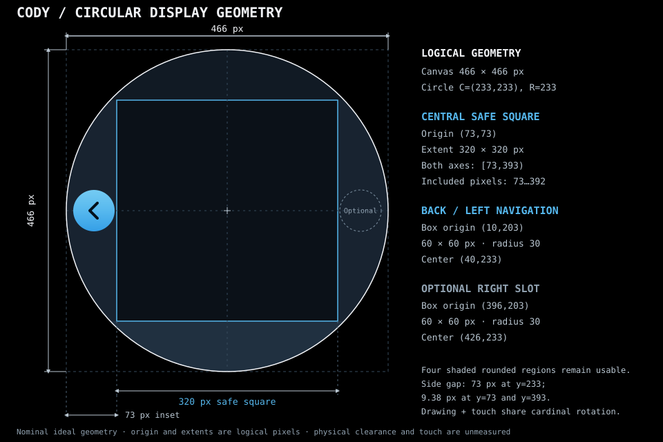

# Waveshare circular display geometry

This is the nominal geometry of the current Waveshare ESP32-S3 Touch AMOLED
1.75 adapter. Other Espressif boards supply their own resolution, shape, driver
and touch transform. Coordinates here do not define a generic BSP screen size.



| Region | Logical bounds |
| --- | --- |
| Canvas | [0,466) x [0,466), pixels 0 through 465 |
| Circle | Center (233,233), radius 233 |
| Baseline safe square | [73,393) x [73,393), 320 x 320 |
| Left navigation slot | (10,203), 60 x 60, radius 30, center (40,233) |
| Right navigation slot | (396,203), 60 x 60, center (426,233) |

The 73-pixel inset is measured at the horizontal center. It is not the available
width at every row. For continuous layout coordinates:

```text
half_width(y) = sqrt(233^2 - (y - 233)^2)
left(y)       = 233 - half_width(y)
right(y)      = 233 + half_width(y)
left_side_space(y)  = max(0, 73 - left(y))
right_side_space(y) = max(0, right(y) - 393)
```

| y | Left x | Right x | Space outside the square per side |
| ---: | ---: | ---: | ---: |
| 73 | 63.62 | 402.38 | 9.38 |
| 100 | 41.69 | 424.31 | 31.31 |
| 150 | 15.28 | 450.72 | 57.72 |
| 203 | 1.94 | 464.06 | 71.06 |
| 233 | 0.00 | 466.00 | 73.00 |
| 263 | 1.94 | 464.06 | 71.06 |
| 316 | 15.28 | 450.72 | 57.72 |
| 366 | 41.69 | 424.31 | 31.31 |
| 393 | 63.62 | 402.38 | 9.38 |

A tall rectangle must fit the narrowest chord it occupies. The mathematical
largest inscribed square is approximately 329.51 pixels; 320 is the adopted
baseline. About 40 percent of the disk is outside it. Controls and artwork may
use that space with explicit chord, clipping and navigation admission.

## Orientation and consumers

Rendering, clipping and touch share logical 0/90/180/270-degree coordinates.
Navigation stays visually left in the chosen orientation. Text is never mirrored
and touch is never rotated independently. The controller's six-pixel address gap
is hardware calibration, not an additional UI inset.

[Cody layout](../../../cody/layout.md) owns native controls and QR placement.
[Luna UI guidelines](../../../luna-shell/ui-guidelines.md) own LVGL chrome and
released arc viewports. The [display/touch contract](../../core/display-touch-runtime.md)
owns the atomic hardware transform and redraw requirement.

## Source references and evidence

- `components/esp32_s3_touch_amoled_1_75/include/bsp/display.h`: physical resolution.
- `components/LUNASHELL_app/src/runtime/LUNASHELL_app.cpp`: display/safe-area tokens.
- `components/LUNASHELL_app/gui/root.json`: editable declarative geometry.
- `components/LUNASHELL_app/package/res/templates/LUNASHELL_chrome.json`: navigation slots.
- `components/LUNASHELL_app/src/chrome/LUNASHELL_edge_navigation.cpp`: route admission.
- `simulator/windows/lunashell_simulator.py`: synthetic viewport presentation.

These are source geometry and mathematical bounds, not bezel measurements,
physical touch calibration or a claim that all application routes conform.
