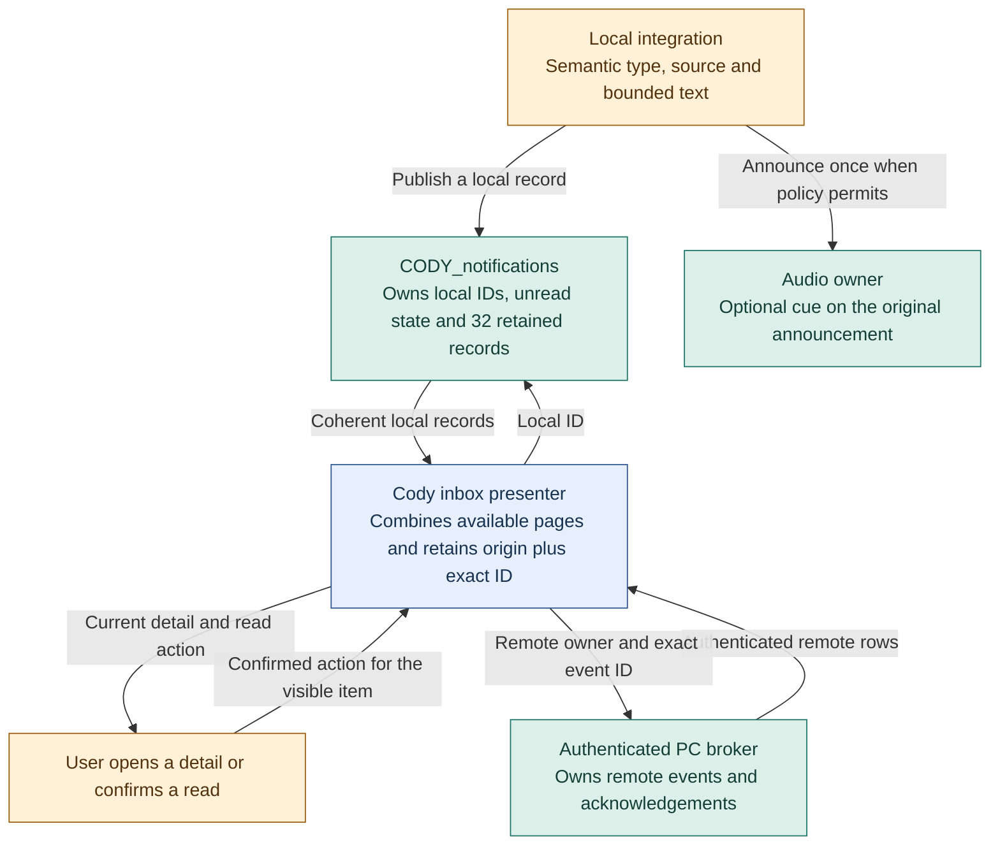

> **File name** `notifications.md` 
> **Full path** `E:\Cody\esp32-luna-shell\docs\cody\notifications.md` 
> **Path relative to the repository root** `docs/cody/notifications.md`

# Device notifications

Notifications use semantic types independent of their provider: `Message`,
`Information`, `Question`, `Success`, `Warning` and `Error`. The type selects an
existing semantic icon and color. A source label identifies the integration or
originating chat separately from the notification title and detail.

`CODY_notifications` owns local device notifications. Producers supply a type,
printable ASCII source, title, detail and positive monotonic arrival time. The
owner assigns a stable ID and unread state. Invalid or oversized input is
rejected without replacing a retained record. No account-specific information
is inferred from other sources.

The local history holds 32 records in RAM, newest first, with coherent pages of
three records. Marking an exact ID read preserves the record. A full history
replaces its oldest record and exposes the replacement count. The history
survives provider disconnects and reconnects during the same boot; restart or
power loss clears it. It performs no persistent writes and does not use the
WhatsApp credential partition.

The authenticated Codex broker remains the owner of remote events and their
acknowledgements. The UI must preserve the origin and exact owner ID when
merging sources, opening a detail or confirming a read. Local actions do not
require the PC. A touch acquired before a row changes must never confirm the
replacement row. Source unavailability must not hide the other source's
retained history.

The current merged list places retained local records first, newest first,
followed by the broker's remote ordering. Read local records remain in that
section until replaced or restarted. Remote requests retain the broker's own
question priority within its section. A remote page being fetched is labelled
as updating; rows from another page are not substituted into its positions.

Banner display, sound playback and read state are separate. A producer may
announce a new notification once through the existing audio owner. Reading,
scrolling, reopening and marking history read do not replay that sound.

WhatsApp currently publishes type `Message`, source `WhatsApp` and title
`New message`. Its notification-only protocol API exposes neither sender nor
message content. Those fields remain unavailable in the detail. Other local
integrations use the same publication and read APIs without adding a
provider-specific list or notification type.

This is a source contract. Firmware integration, memory headroom, display,
touch, sound and delivery behavior require separately authorized verification.

> **File name** `notifications.md` 
> **Full path** `E:\Cody\esp32-luna-shell\docs\cody\notifications.md` 
> **Path relative to the repository root** `docs/cody/notifications.md`
