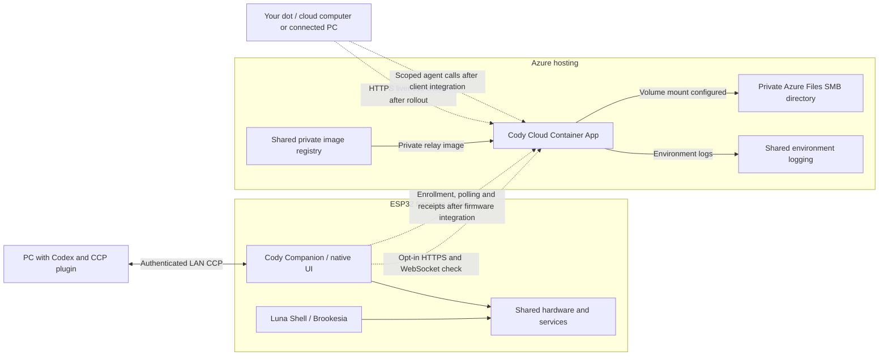

# Cody remote integration with Dot and Azure

Cody Companion uses authenticated CCP on the local Wi-Fi network. Luna Shell is
the separate Brookesia interface on the same hardware platform. The private Cody
Cloud relay is intended to connect an authorized remote agent to Cody Companion.
The relay runs on Azure Container Apps. Its HTTPS liveness route is separate
from the authenticated MCP, device and administrator routes.

Solid links show existing source paths or infrastructure configuration. Dotted
links depend on deployment or integration. An attached volume establishes the
platform mount configuration. Relay storage readiness still requires acceptance.

## Check from Dot or from Cody

Dot has its own cloud computer and can use a separately connected PC for work
that depends on that PC's files, tools or network. Keep the connected PC online
with ChatGPT open for those tasks. Run the probe from a host that can reach the
approved origin. A check of cloud-only operation must originate on Dot's cloud
computer. An ingress rule allowing only the connected PC's public IP supports
checks from that PC. Cloud access requires its own supported network policy.
[Connect computers to your dot](https://learn.chatgpt.com/docs/dots/computers-and-apps)

Once the relay image and approved HTTPS ingress are active, give Dot the
following instruction, substituting the deployed origin for `relay.example.com`.

> Send one HTTPS GET to `https://relay.example.com/health/live` with a five-second
> timeout. Verify TLS and do not follow redirects. Report the time, source host,
> HTTP status, and whether the JSON is `{"status":"alive"}`. If it fails, report
> whether DNS, TCP, TLS, the HTTP status or the response body failed. Use no
> credentials for this check.

HTTP 200 and the expected body establish liveness from that host. Azure
provisioning status reports infrastructure state. Storage readiness needs a
separate check of the mounted share and exclusive writer. Delivery needs an
authorized event and its matching device receipts. The platform's own probes
need explicit configuration compatible with the relay's HTTPS and host checks.
[Azure Container Apps health probes](https://learn.microsoft.com/en-us/azure/container-apps/health-probes)

For a device-side check, an authorized `cody-companion` build using
`-RelayHost <dns-name>` exposes **Options → Connections → Check relay**. The
device needs working Wi-Fi and valid time for certificate verification. The
check first calls the HTTPS liveness route, then upgrades to a secure WebSocket
at /health/websocket and verifies one fixed diagnostic frame and a normal close.
The WebSocket health route carries only the diagnostic frame. Agent and device
operations retain their own authentication. [Cody navigation](navigation.md#start-and-connect)

## Deliver a notification

The private relay source implements scoped agent calls, owner-approved device
enrollment, outbound device polling, expiry and delivery receipts. Once the
firmware and client are integrated, the agent uses its own scoped credential and
the owner grants that identity access to a selected device. Cody uses a separate
proof-bound device credential. A queued event has been accepted by the relay.
The device reports reception and display separately. [Open work](../../TODO.md)

A connected PC running Codex is a candidate MCP client because Codex supports a
bearer token sourced from its environment. Hosted ChatGPT plugins require a
supported authentication flow for protected tools and cannot present custom API
keys. Validate the actual Dot route and tool permissions before enabling writes.
[Codex MCP configuration](https://learn.chatgpt.com/docs/extend/mcp) ·
[ChatGPT plugin authentication](https://developers.openai.com/plugins/build/auth)

## Publication boundaries

| Surface | Publication boundary |
| --- | --- |
| Cody firmware, Luna Shell, CCP plugin and this guide | Public repository under its existing license and third-party notices. Publish architecture and generic examples. |
| Cody Cloud server source and container image | Proprietary source checkout and private image registry. Publish the built image to the private registry for deployment. |
| Relay HTTPS origin | Enable ingress after source deployment and acceptance. The minimal liveness response may be exposed on the approved origin. MCP, device operations and the operator portal retain their distinct authentication and authorization. |
| Infrastructure and user data | Keep the full Azure inventory, credentials, private paths, device identities, relay state, messages and operational telemetry private. Keep the SMB share, registry and dashboard restricted. |

## Deployment requirements

The first application deployment must supply the image, complete configuration,
process-environment credentials and provisioned SMB state together. Startup
validates configuration and acquires the state lock before accepting HTTP
requests. Use the standard Windows PowerShell, .NET and Aspire tools through
`scripts/device.ps1 relay`. The private Aspire AppHost describes the existing
Container App. The Aspire CLI handles packaging, provisioning and publication from current
source. Stage official dependencies under the repository's first-import rules.
Linux remains the Azure workload target, whose runtime and SMB behavior require
their own acceptance. See the [release commands](../../scripts/README.md#private-relay-through-aspire).

The publisher needs explicit control over exposure. Prepare the relay with
external ingress disabled, then activate the approved HTTPS origin after its
startup requirements are met. Check the generated public origin, allowed host,
forwarded-header handling and platform probes as one deployment configuration.
[Azure Container Apps ingress](https://learn.microsoft.com/en-us/azure/container-apps/ingress-overview)

For subsequent updates, stop and confirm termination of the existing writer
before starting the replacement. Azure's single-revision rollout normally keeps
the old revision running until the replacement is ready. With an effective SMB
exclusive lock, the replacement cannot acquire state while that writer lives.
The publication workflow must handle this transition explicitly, including
failure recovery. Preserve the state and lock file identities through the
transition. [Azure revision lifecycle](https://learn.microsoft.com/en-us/azure/container-apps/revisions)

Platform startup, process liveness and storage readiness need deliberate probe
contracts. The existing public liveness route requires HTTPS and the configured
host. A direct HTTP platform probe cannot use it unchanged. An external HTTP
200 establishes reachability from the checking host. Storage acceptance and
device receipts remain separate requirements. Complete these gates in the
[existing relay and device work items](../../TODO.md).
