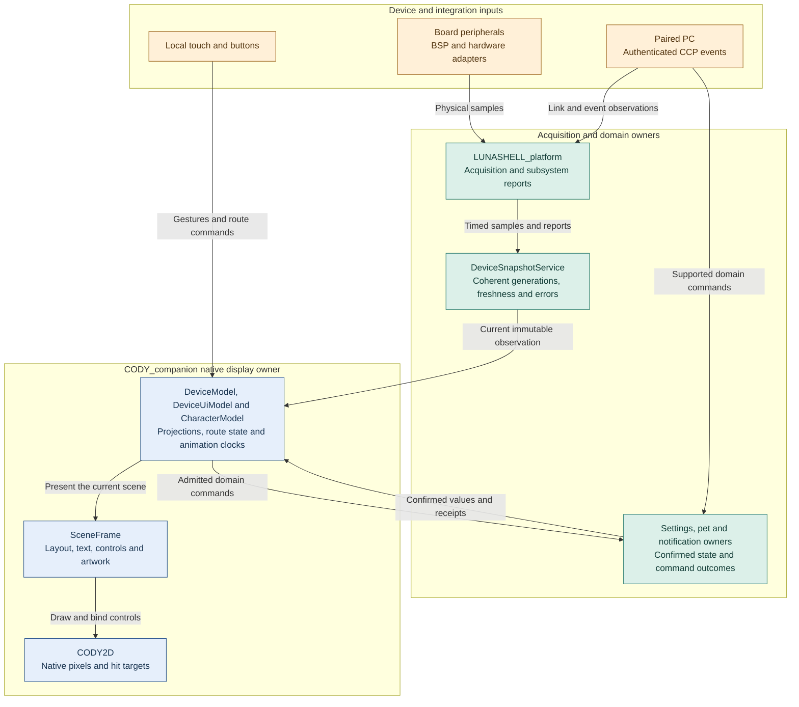
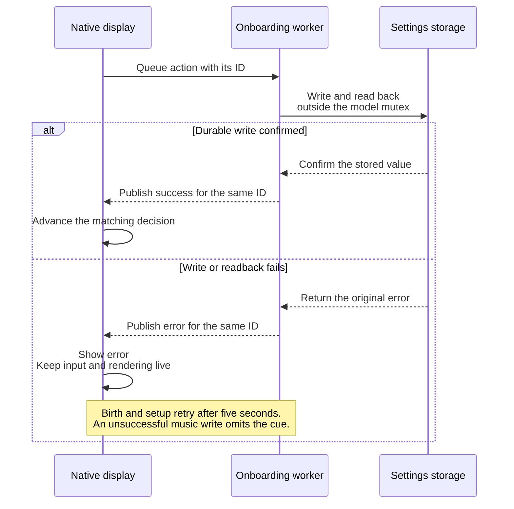
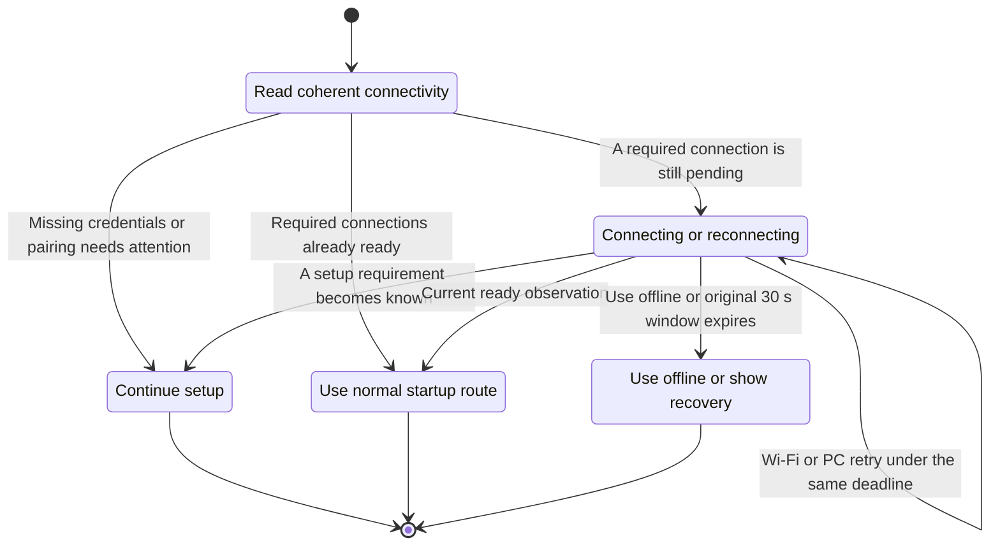

> **File name** `runtime.md` 
> **Full path** `E:\Cody\esp32-luna-shell\docs\cody\runtime.md` 
> **Path relative to the repository root** `docs/cody/runtime.md`

# Cody behind the experience

**VibeWare · Cody Companion**

**Author:** Umberto Giacobbi · **Created:** 2026-10-04 · **Updated:** 2026-11-20 · **Revision:** 1.0

A friendly face is only part of the story. This guide brings together the product's main boundaries, future ideas and pointers for anyone who wants to explore the source.

## The experience today

The source brings together the VibeWare startup, Cody's character, device settings and a local Codex connection. Supported behavior depends on the selected board and build. The physical experience, timing, audio and other outstanding checks remain in [TODO.md](../../TODO.md).

The 1.75 GPS prototype supports removable microSD; the 1.75C does not. The boards have different capabilities, so a feature on one should not be assumed on the other. See the [hardware guide](../bsp/boards/purchased-amoled-comparison.md).

## Runtime at a glance

Blue identifies the display owner. Green identifies state owners, and amber
identifies devices and clients outside the display's ownership.

[Device snapshot ownership and refresh](../bsp/core/device-snapshot.md) ·
[Local PC pairing and replies](../../cody-desktop/plugins/cody-codex-plugin/protocol/CCP1.md) ·
[Controlled captures in Studio](../../cody-device/simulator/windows/architecture.md)

## State ownership and onboarding commands

The native display controller composes independent models. `DeviceModel` holds
consumer projections from `DeviceSnapshotService` and domain owners, including
source validity and errors. `DeviceUiModel` and `UiState` hold routes, gestures,
viewports, drafts and retired presentation. `CharacterModel` holds poses,
animation clocks, applied visual style and cue identities; pet facts remain in
the pet domain service. `SettingsModel` is owned by `SettingsService`; the UI
borrows confirmed values and retains command identities, never a separate
persisted settings store.

Lifecycle writes use the existing onboarding action worker. The display queues
first-boot music consumption, birth completion and setup completion and observes
an exact receipt. Storage and readback run outside the model mutex. Birth/setup
failures keep their original error and retry after five seconds without stopping
touch, rendering or power command handling. The shared status-caption slot shows
`Settings not saved: retrying` until a successful receipt. A failed first-boot
music write omits playback and shows `Boot sound settings not saved`; it does not
silently consume or replay the cue. Music admission has its own three-second
window after durable confirmation and a separate bounded storage wait.

Settings presenters capture each required domain once and use pure projections
for comparison with the last presented values. Quiet-hours edits retain a local
draft while canonical values and constraints follow remote changes. Tour storage
identities remain stable: 5 is completed/skipped and 6 is Thanks. Page metadata,
guide presentation and Wi-Fi presentation are separate from action admission.
On first run Welcome and Let's connect precede the Wi-Fi choices; Later records
an explicit offline choice. A confirmed Wi-Fi connection presents a result page
before the guide. The Project tour
identity is the durable handoff to the optional Codex choice; a confirmed skip
or connection reaches Thanks, while cancellation waits for the existing cleanup
owner. Replaying from Thanks does not rewrite intermediate first-run progress;
replay from Settings does not start provisioning. A firmware without wake word
does not navigate through the Sofia page. The tutorial uses the shared Muse
renderer and pet cue admission; sounds still follow the shared sound and quiet
hours policy. Wi-Fi particles reflect an admitted local operation, not progress.
The indexed-image renderer caches one 512-byte palette per owner and clips into
existing DMA tiles; opaque full-panel artwork skips a redundant clear. Original
Welcome and boot audio assets remain in the repository even where their unused
firmware embeddings have been removed.

The display handles setup persistence through an existing worker. The receipt
is tied to the exact requested action.

## Startup connection window

Saved setup opens one Connecting/Reconnecting window lasting at most 30 seconds.
Its deadline never restarts for a Wi-Fi retry or a new PC discovery attempt.
The display reads a coherent connectivity observation and reports the actual
Wi-Fi/IP/PC phase. A fresh authenticated CCP READY ends the wait early; an
optional capability error remains in the model without invalidating that READY.
Missing credentials or pairing return to setup without an artificial wait.

Cody uses the existing avatar buffer for waking, thinking, listening and waiting
poses. These animations do not create events or claim successful connection.
Use offline retires the window immediately; timeout returns to the existing
offline/setup recovery. Radio owners continue their existing retry policy.
Snapshot-read errors remain visible without using an old observation or stopping
the display during this boot/recovery flow. Physical timing and rendering still
require acceptance.

The short Wi-Fi-ready reaction uses the original deadline. Its visual feedback
reports Wi-Fi separately from authenticated PC readiness.

## Minimal character direction

Cody can respond to observed activity with small expressions and movements. Some reactions require a current, matching chat and turn. They are artistic cues, not measurements of a person's feelings or proof that a task is complete. See [Meet Cody](behavior.md) and [expressions](personality-icons.md).

## Device-first notifications

Cody can present connection changes, questions and other supported events. Sounds respect the user's settings and quiet hours. A question answer is delivered only when the receiving side confirms it; pending or ambiguous outcomes stay distinct. More detail is in the [PC plugin](../../cody-desktop/plugins/cody-codex-plugin/README.md) and [CCP protocol](../../cody-desktop/plugins/cody-codex-plugin/protocol/CCP1.md).

## Clock presentation

Cody uses available time information for its clock and time-based presentation. Auto time uses network time; **Sync time** requests a fresh network sample even when Auto time is off. Connecting a PC does not automatically set the clock or offset. The device stores UTC and uses the configured offset for local display; a cold boot without a usable clock source can show time as unavailable. See the [time service](../bsp/services/time.md).

## One-way voice input source increment

Speech and voice input are separate features. The default Cody profile includes English flash speech but omits microphone acquisition; the explicit `none` variant omits synthesis and microphone acquisition. The Cody wake-word variant combines Sophia for standby wake, English flash speech and the voice-input owner, which hands recorded audio to the paired PC. A ready connection and supported desktop configuration are required; queue admission does not establish transcription or that the model understood the recording. Physical behavior still needs verification. See [wake on word](../bsp/services/wake-on-word.md).

## The road ahead

Ideas for Cody include richer awareness, targeted messages, work controls and reminders. They are plans, not a claim that every action is available. Voice and usage screens were deferred. The current priorities, prerequisites and verification gates are in [TODO.md](../../TODO.md) and [planned-todo.md](../../planned-todo.md).

The direction is to first make activity and attention easier to understand, then explore choosing a specific chat, sending a reviewable message and requesting an update. Later ideas include stopping work, opening a chat on the PC and reminders. Each needs a supported connection to the intended chat and a clear result; Cody must not guess a target, silently repeat an uncertain request or treat a request as completed work.

The multi-chat work distinguishes sources, chats, turns, calls and questions so an action can target the right item. A local bookmark does not change the PC's followed chat. Read the [domain types](../../cody-device/components/CODY_domain/include/CODY_domain_types.hpp), [domain component](../../cody-device/components/CODY_domain/README.md) and [state protocol](../../cody-desktop/plugins/cody-codex-plugin/protocol/CODY_STATE_V1.md) for implementation details.

## Remote connections

The normal Cody-to-PC connection uses authenticated CCP on the local network. A private cloud relay is a separate, evolving project. An optional device build can check relay reachability; that check alone does not establish enrollment or event delivery. Remote enrollment, device delivery and operational acceptance remain open. The relay source and infrastructure are private; credentials, device identities and messages do not belong in public documentation. See [relay commands](../../scripts/README.md#private-relay-through-aspire) and [open work](../../TODO.md).

The relay's public liveness check, protected agent and device routes, and storage readiness are separate concerns. Replacing a running relay also requires a deliberate handover of its single storage writer; a successful health response alone does not prove storage or delivery is working.

## Experiments and source

An experimental activity observer uses pretrained model labels for a limited set of movements. It is not available in the Cody profile and is not an automatic power policy. The original model weights have no identified license and are not included in the repository; permission to distribute firmware containing them remains unresolved.

Cody uses a native 2D interface. The [companion source](../../cody-device/components/CODY_companion/), [CODY2D source](../../cody-device/components/CODY2D/) and [shared platform](../../cody-device/components/LUNASHELL_platform/) are the best places to explore technical details. The [screen catalog](screen-catalog.md) preserves original screen identities and evidence; [layout](layout.md) and the [design system](design-system.md) preserve the interface contracts.

---

**VibeWare** · Created by Umberto Giacobbi · [Cody on GitHub](https://github.com/umbertotechnopreneur/esp32-luna-shell) · [VibeWare](https://github.com/umbertotechnopreneur/VibeWare)

> **File name** `runtime.md` 
> **Full path** `E:\Cody\esp32-luna-shell\docs\cody\runtime.md` 
> **Path relative to the repository root** `docs/cody/runtime.md`
