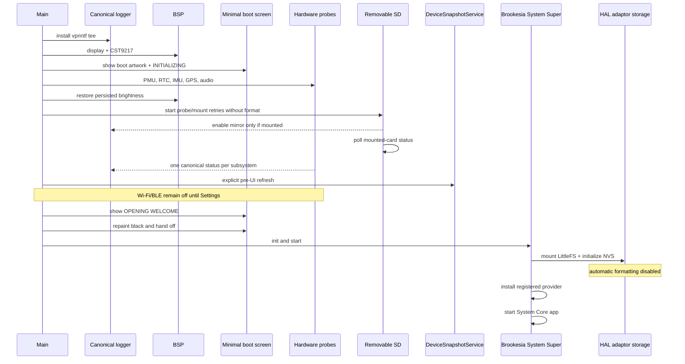

# Luna startup and Brookesia handoff

This sequence describes the full Luna/Brookesia path. Cody owns its separate
[native lifecycle](../cody/runtime.md); the minimal display/touch profile has
[mandatory display and touch admission](../bsp/core/display-touch-runtime.md).
Optional failures described below belong to this orchestrator's scope.

Logger initialization is attempted before platform startup. Logging is optional:
failure remains logged/published without stopping the hardware/UI path. Its
capture/queue/storage contract is in [storage and logging](../bsp/services/storage-and-logging.md).

## Boot sequence

`LUNASHELL_hardware_init()` runs PMU, RTC, IMU, GPS, and audio initialization in a
fixed order and returns at its first failed stage. The main orchestrator
explicitly allows hardware inventory, time, boot audio, removable
storage, and the pre-UI refresh to fail while continuing to the UI; their real
errors remain in the logger and `DeviceSnapshotService`. Touch unavailability
is also reported without stopping the handoff.

Boot power preparation, memory telemetry/liveness, display startup, an enabled
boot screen, persisted brightness/wake-display restoration and the ready/handoff
transition stop their stage on failure. Enabled power-input initialization is
also required. Missing touch is reported, while failure to install the activity
observer for an available touch device stops the handoff. Brookesia task creation,
readiness and selected board-service sampling retain their explicit failure gates.
A later System Super or app launch failure ends the Brookesia launch task
while leaving the canonical logger active. No failure is converted to success,
and ambiguous recovery stops the failing stage.

## Brookesia application boundary

System Super owns the system lifecycle and services. System Core discovers the
registered provider, creates its native `IApp`, and drives its
start/stop/action/timer callbacks. GUI LVGL loads only the resident bootstrap
from `/littlefs/<app-package>/res/root.json` during app startup. That document
owns the background, shared chrome, Welcome screen, and an empty content target.
Every other route is stored in an independent `res/screen_*.json` document.
System Core loads and mounts the requested route document, then unloads it
before mounting another; at most one lazy route document is active.

The editable declarative source is `components/LUNASHELL_app/gui/root.json`.
`scripts/generators/generate_LUNASHELL_gui_documents.py` emits the bootstrap and independently
loadable route documents staged in LittleFS. The native app selects documents
and binds values through the GUI interface. It reads hardware telemetry only
from `DeviceSnapshotService`; the Logs screen reads only the canonical logger
ring. Search uses the System Super keyboard service, and SD formatting uses the
System Super message-dialog service. Settings owns the explicit radio-start
action and persisted display/device preferences.

## Internal resources and removable storage

System Super's HAL mounts internal LittleFS and supplies its NVS backend with
automatic formatting disabled. The firmware separately owns removable SD;
System Super's SD backend is disabled. The shared
[storage contract](../bsp/services/storage-and-logging.md#storage-lifecycle)
owns absence, transport failures, format-required admission and one-shot consent.

## Evidence

Current startup/dependency gates are in [TODO.md](../../TODO.md). Earlier serial
captures and builds retain their profile, date and checkpoint in
[done.md](../../done.md); they do not establish another profile's behavior.
